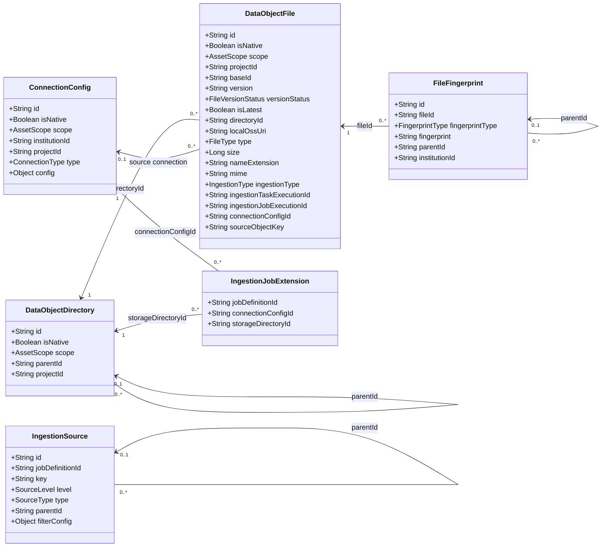
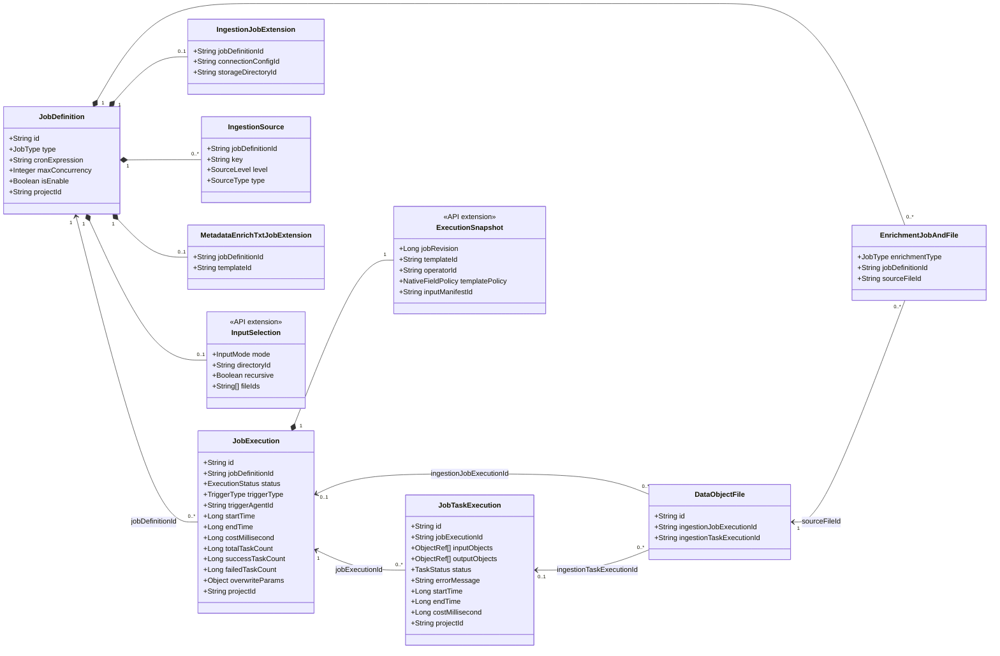
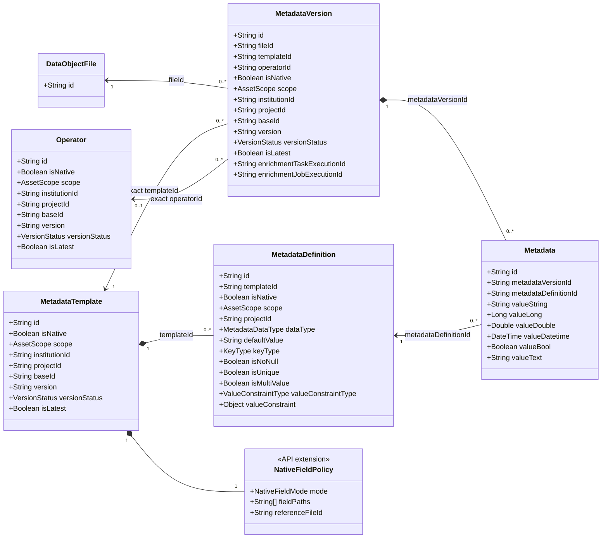
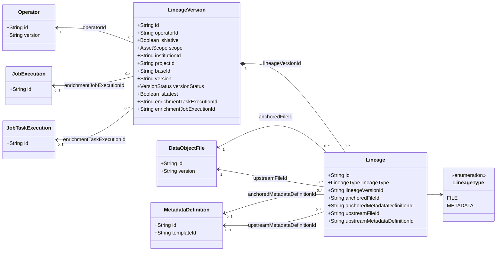
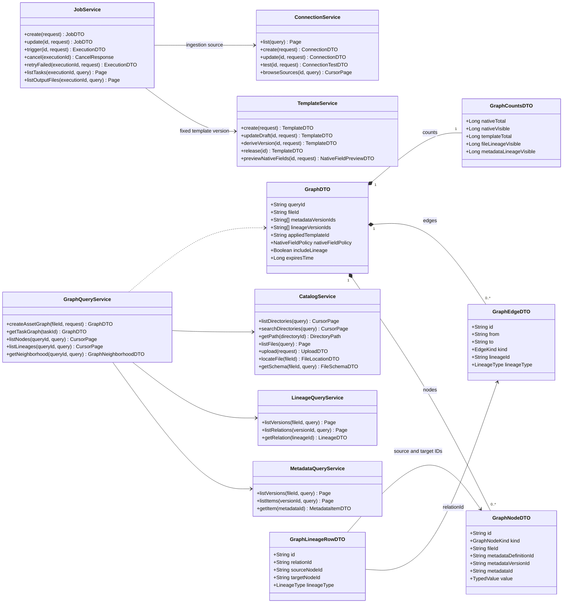

# 数据与元数据接口清单及类图

版本：v2.0；更新日期：2026-10-19。依据：[飞书文档最新 ER 图](https://synxlab-ta.feishu.cn/wiki/KPMWwUTLliOBAykIA5Bccf77nIg)及当前前端。

本文为目标接口设计，URI 不代表现有后端已实现。只包含接口约定、详细接口清单、请求/响应结构和类图。

## 1. 接口约定

### 1.1 通用请求与响应

| 项目 | 约定 |
| --- | --- |
| URI | 下文均为完整业务路径，统一前缀 `/api/v1` |
| 请求格式 | 除上传外，Body 使用 `application/json`；上传使用 `multipart/form-data` |
| 参数位置 | Path 为路径参数；Query 为查询参数；Header 为请求头；Body 为 JSON 请求体；Form 为上传表单 |
| ID | 所有 ID 均为 String，引用确定版本；`baseId` 表示跨版本的逻辑身份 |
| 时间 | Long，UTC 时间戳，单位毫秒；未开始/结束的时间为 null |
| 版本 | `version` 为语义版本 String；`revision` 为并发修订号 Long，两者不同 |
| 登录上下文 | 所有请求携带既有登录凭证；`X-Institution-Id`、`X-Project-Id` 为当前选择上下文，String、可选；服务端验证账号关联关系 |
| 归属字段 | `scope=GLOBAL` 时 institutionId/projectId 为空；INSTITUTION 必须有 institutionId；PROJECT 必须同时有 institutionId、projectId |
| 更新并发 | 更新、发布、归档、删除请求要求 Header `If-Match`，值为详情响应 ETag；不一致返回 412，未提供返回 428 |
| 执行幂等 | 触发执行、失败重试要求 Header `Idempotency-Key`，String，必填；同账号同键同请求返回原执行，不同请求返回 409 |
| 普通成功 | 200，直接返回所列 DTO；创建资源为 201 并返回 Location；异步为 202；无响应体为 204 |
| 页码分页 | `page: Integer=1`、`pageSize: Integer=20`，均可选，pageSize 最大 200；响应 `Page<T>` |
| 游标分页 | `cursor: String?`、`limit: Integer=100`，均可选，limit 最大 500；响应 `CursorPage<T>` |
| 排序 | Query `sortBy: String?`、`sortOrder: ASC/DESC=DESC`；仅允许各接口列出的字段，服务端追加 id 排序保证稳定 |
| 可空属性 | DTO 中“可空”表示 JSON 返回 null；不随资源类型使用的可选扩展对象可以省略 |

统一目录不因单位/项目切换复制或重建。级别通过文件/连接/模板的 scope 展示；上下文入口与既有账号体系衔接。

```json
{
  "items": [],
  "total": 0,
  "page": 1,
  "pageSize": 20
}
```

上例为 `Page<T>`。`CursorPage<T>` 为 `{items: T[], nextCursor: String|null, hasMore: Boolean}`。不分页的列表使用明确的对象字段，不与这两种结构混用。

统一错误响应 `ErrorResponse`：

```json
{
  "code": "INVALID_ARGUMENT",
  "message": "请求参数不合法",
  "traceId": "trace-001",
  "fieldErrors": [
    { "field": "enrichment.input.fileIds", "reason": "至少选择一个有效文件" }
  ]
}
```

| HTTP 状态 | code | 含义 |
| --- | --- | --- |
| 400 | INVALID_ARGUMENT | 参数类型、必填、格式或组合错误 |
| 401 / 403 | UNAUTHENTICATED / FORBIDDEN | 未登录/无权访问 |
| 404 | RESOURCE_NOT_FOUND | 资源不存在 |
| 409 | INVALID_STATE / RESOURCE_IN_USE / DIRECTORY_CYCLE / EMPTY_INPUT / RESULT_NOT_READY / IDEMPOTENCY_CONFLICT | 状态冲突、被引用、目录成环、空输入、结果未就绪或幂等冲突 |
| 410 | GRAPH_QUERY_EXPIRED | 固定版本的图谱查询已过期 |
| 412 / 428 | REVISION_CONFLICT / PRECONDITION_REQUIRED | 修订号冲突/缺少并发前置条件 |
| 422 | INVALID_TEMPLATE / INVALID_LINEAGE_ENDPOINT / UNSUPPORTED_PARSER | 业务内容无法处理 |

### 1.2 枚举

| 名称 | 值 | 说明 |
| --- | --- | --- |
| AssetScope | GLOBAL / INSTITUTION / PROJECT | 平台级/单位级/项目级 |
| FileType | STRU / SEMI_STRU / UNSTRU | 对应 ER `do_file.type`：结构化/半结构化/非结构化 |
| ConnectionType | DB / OSS / DOCS / API / LLM | 数据库/对象存储/在线文档/API/模型 |
| JobType | INGESTION / EXPORT / ENRICH_TXT / ENRICH_LIN / ENRICH_ONT | 本文不展开 EXPORT 业务接口 |
| ContentMode | CONTENT / TEXT | 内容孵化/文本孵化，同属 ENRICH_TXT |
| SourceLevel | CONTAINER / OBJECT | 源容器/源对象 |
| SourceType | DB_SCHEMA / OSS_BUCKET / DOCS_SPACE / API_SERVICE / DB_TABLE / DB_VIEW / OSS_FILE / DOCS_DOC / API_ENDPOINT | 与 ER 采集源一致；父子类型受连接器能力约束 |
| DuplicatePolicy | OVERWRITE / DISCARD | 创建新版本/跳过已有来源；不以文件名作为唯一判重依据 |
| ExecutionStatus | QUEUED / RUNNING / SUCCESS / PARTIAL_SUCCESS / FAILED / TERMINATED / CANCELED | QUEUED 为接口排队展示状态 |
| TaskStatus | PENDING / RUNNING / SUCCESS / FAILED / SKIPPED / CANCELED | PENDING/RUNNING/CANCELED 补足前端过程展示 |
| TriggerType | MANUAL / CRON / EVENT | 手工/定时/事件 |
| IngestionType | MANUAL / INTELLIGENT | 对应 ER ingestion_type |
| FileVersionStatus | ACTIVE / ARCHIVED / DELETED | 文件版本状态 |
| VersionStatus | DRAFT / RELEASED / ARCHIVED | 模板/算子/结果版本状态 |
| ParseStatus | PENDING / RUNNING / SUCCESS / FAILED / UNSUPPORTED | 文件原生结构解析状态 |
| NativeFieldMode | ALL / SELECTED / NONE | 全部/部分/不纳入原生字段 |
| MetadataDataType | STRING / LONG / DOUBLE / DATETIME / BOOL / TEXT | STRING/LONG/DOUBLE/DATETIME 为 ER 定义枚举；BOOL/TEXT 与 ER 值列对应，作为接口类型补充 |
| KeyType | PRIMARY_KEY / UNIQUE_KEY | 无键约束时为 null |
| ValueConstraintType | NONE / REGEX / ENUM / RANGE / EXPR | 值约束 |
| MetadataOrigin | STANDARD / NATIVE / TEMPLATE | 标准信息/解析的原生字段/模板孵化字段；接口展示分类，不与 isNative 混同 |
| MetadataResultKind | NATIVE / INCUBATED | 原生解析结果/模板孵化结果，接口区分 |
| LineageType | FILE / METADATA | **按更新 ER：数据对象血缘/元数据定义血缘**，不再使用 DATA_OBJECT 作为接口枚举 |
| FingerprintType | ETAG / MODIFY_TIME / REVISION / HASH_MD5 / HASH_SHA256 | 对应文件指纹 |

## 2. 详细接口清单

每张清单的“请求参数”列列出该接口全部业务参数；公共登录、更新前置条件、分页参数遵循第 1 节。“响应结果”中的 DTO 均在第 3 节逐字段定义。`?` 表示非必填，其余为必填。

### 2.1 单位与项目入口

| 接口名称 | 方法 | URI | 请求参数 | 响应结果 |
| --- | --- | --- | --- | --- |
| 获取账号工作空间 | GET | `/api/v1/me/workspaces` | 无业务参数 | 200 `WorkspaceDTO`：账号、平台、关联单位、单位下项目、默认上下文 |

### 2.2 资产目录

| 接口名称 | 方法 | URI | 请求参数 | 响应结果 |
| --- | --- | --- | --- | --- |
| 查询目录子节点 | GET | `/api/v1/directories` | Query：`parentId: String?`，空为统一根的直属节点；cursor、limit | 200 `CursorPage<DirectoryDTO>`，每节点带 hasChildren、完整路径 |
| 搜索目录树 | GET | `/api/v1/directories/search` | Query：`keyword: String`；`rootId: String?`，限定聚焦分支；cursor、limit | 200 `CursorPage<DirectoryMatchDTO>`，每条含命中节点及完整祖先链 |
| 获取目录详情 | GET | `/api/v1/directories/{directoryId}` | Path：`directoryId: String` | 200 `DirectoryDTO`，返回 ETag |
| 获取目录路径 | GET | `/api/v1/directories/{directoryId}/path` | Path：`directoryId: String` | 200 `{directoryId: String, ancestors: DirectoryBriefDTO[], self: DirectoryBriefDTO}`，ancestors 从根到父目录 |
| 新建目录 | POST | `/api/v1/directories` | Body：`name: String`，1～128 字符；`parentId: String`；`description: String?` | 201 `DirectoryDTO` |
| 修改或移动目录 | PATCH | `/api/v1/directories/{directoryId}` | Path：directoryId；Body：`name: String?`、`description: String?`、`parentId: String?`，至少一项；If-Match | 200 `DirectoryDTO`；自身/后代作为父目录返回 DIRECTORY_CYCLE |
| 删除空目录 | DELETE | `/api/v1/directories/{directoryId}` | Path：directoryId；If-Match | 204 无响应体；根目录不可删，非空返回 RESOURCE_IN_USE |

右键聚焦使用目录详情、子节点和路径接口；focusDirectoryId 是前端状态，不提交“移动目录”接口。

### 2.3 数据对象文件与上传

| 接口名称 | 方法 | URI | 请求参数 | 响应结果 |
| --- | --- | --- | --- | --- |
| 分页查询文件 | GET | `/api/v1/files` | Query：`directoryId: String`；`recursive: Boolean=false`；`keyword: String?`；`type: FileType?`；`assetScope: AssetScope?`；`latestOnly: Boolean=true`；page、pageSize；sortBy=name/size/createdTime，默认 createdTime | 200 `Page<FileDTO>` |
| 获取指定文件版本 | GET | `/api/v1/files/{fileId}` | Path：`fileId: String`，确定版本 ID | 200 `FileDTO`，返回 ETag |
| 查询文件版本列表 | GET | `/api/v1/files/{fileId}/versions` | Path：fileId；Query：page、pageSize | 200 `Page<FileDTO>`，仅返回同 baseId 版本 |
| 获取文件目录定位 | GET | `/api/v1/files/{fileId}/location` | Path：fileId；Query：`pageSize: Integer=20`，最大 200 | 200 `FileLocationDTO`，供记录跳转、展开祖先和定位分页 |
| 移动文件 | PATCH | `/api/v1/files/{fileId}/location` | Path：fileId；Body：`directoryId: String`；If-Match | 200 `FileLocationDTO`；只修改当前归档位置，历史执行的输入快照不变 |
| 查询原生结构 | GET | `/api/v1/files/{fileId}/schema` | Path：fileId；Query：`datasetKey: String?`、`keyword: String?`；page、pageSize | 200 `FileSchemaDTO`，原生字段不受模板过滤 |
| 获取临时下载地址 | GET | `/api/v1/files/{fileId}/download-url` | Path：fileId | 200 `{fileId: String, url: String, expiresTime: Long}` |
| 上传数据对象 | POST | `/api/v1/file-uploads` | Form：`file: Binary`、`directoryId: String`、`scope: AssetScope`；`institutionId: String?`、`projectId: String?` 按 scope 条件必填；`type: FileType?`，省略由服务识别；`description: String?` | 202 `UploadDTO`，返回 fileId 与 statusUrl |
| 查询上传处理进度 | GET | `/api/v1/file-uploads/{uploadId}` | Path：`uploadId: String` | 200 `UploadDTO`，文件入库与结构解析分别返回状态 |
| 删除文件版本 | DELETE | `/api/v1/files/{fileId}` | Path：fileId；If-Match | 204 无响应体；软删除，保留历史任务、元数据及血缘引用 |

### 2.4 数据源连接配置

| 接口名称 | 方法 | URI | 请求参数 | 响应结果 |
| --- | --- | --- | --- | --- |
| 搜索连接配置 | GET | `/api/v1/connections` | Query：`keyword: String?`、`type: ConnectionType?`、`assetScope: AssetScope?`；page、pageSize | 200 `Page<ConnectionDTO>`，用于可搜索下拉框，不返回密钥 |
| 获取连接配置详情 | GET | `/api/v1/connections/{connectionId}` | Path：`connectionId: String` | 200 `ConnectionDTO`，返回 ETag |
| 新建连接配置 | POST | `/api/v1/connections` | Body：`ConnectionWriteRequest`，见 3.4 | 201 `ConnectionDTO` |
| 修改连接配置 | PUT | `/api/v1/connections/{connectionId}` | Path：connectionId；Body：`ConnectionWriteRequest`；If-Match | 200 `ConnectionDTO`；credential 省略保留原凭证 |
| 创建连接测试 | POST | `/api/v1/connections/{connectionId}/tests` | Path：connectionId；Body：`timeoutSeconds: Integer=10`，1～60，可省略整个 Body | 202 `ConnectionTestDTO` |
| 查询连接测试结果 | GET | `/api/v1/connections/{connectionId}/tests/{testId}` | Path：connectionId、`testId: String` | 200 `ConnectionTestDTO` |
| 浏览源端层级对象 | GET | `/api/v1/connections/{connectionId}/source-objects` | Path：connectionId；Query：`parentKey: String?`，空为连接源根；`keyword: String?`；cursor、limit | 200 `CursorPage<SourceObjectDTO>`，供采集源树选择 |
| 删除连接配置 | DELETE | `/api/v1/connections/{connectionId}` | Path：connectionId；If-Match | 204；仍被有效作业引用返回 RESOURCE_IN_USE |

### 2.5 采集与元数据富化作业定义

| 接口名称 | 方法 | URI | 请求参数 | 响应结果 |
| --- | --- | --- | --- | --- |
| 查询作业定义 | GET | `/api/v1/jobs` | Query：`type: JobType?`、`keyword: String?`、`isEnable: Boolean?`；page、pageSize；sortBy=name/createdTime/updatedTime，默认 updatedTime | 200 `Page<JobDTO>`，附 latestExecution 摘要 |
| 新建作业 | POST | `/api/v1/jobs` | Body：`JobWriteRequest`，见 3.5；INGESTION 填 ingestion，三种富化填 enrichment | 201 `JobDTO` |
| 获取作业详情 | GET | `/api/v1/jobs/{jobId}` | Path：`jobId: String` | 200 `JobDTO`，含全部采集/富化配置，返回 ETag |
| 修改作业 | PUT | `/api/v1/jobs/{jobId}` | Path：jobId；Body：`JobWriteRequest`，type 不可变；If-Match | 200 `JobDTO`，仅影响后续执行 |
| 启用或停用作业 | PATCH | `/api/v1/jobs/{jobId}/enabled` | Path：jobId；Body：`isEnable: Boolean`；If-Match | 200 `JobDTO`，不改变已有执行状态 |
| 删除作业定义 | DELETE | `/api/v1/jobs/{jobId}` | Path：jobId；If-Match | 204；有未终态执行返回 RESOURCE_IN_USE；保留历史记录 |

### 2.6 作业执行、子任务与采集文件记录

| 接口名称 | 方法 | URI | 请求参数 | 响应结果 |
| --- | --- | --- | --- | --- |
| 手工触发作业 | POST | `/api/v1/jobs/{jobId}/executions` | Path：jobId；Header：Idempotency-Key；Body：`ExecutionTriggerRequest`，可省略，见 3.6 | 202 `ExecutionDTO`；triggerType 由服务端设为 MANUAL |
| 分页查询执行记录 | GET | `/api/v1/executions` | Query：`jobId: String?`、`type: JobType?`、`status: ExecutionStatus?`、`keyword: String?`、`startTimeFrom: Long?`、`startTimeTo: Long?`；page、pageSize；sortBy=createdTime/startTime，默认 createdTime | 200 `Page<ExecutionDTO>` |
| 获取执行详情与统计 | GET | `/api/v1/executions/{executionId}` | Path：`executionId: String` | 200 `ExecutionDTO`，包括配置快照和 StatisticsDTO，不内嵌无限任务清单 |
| 取消执行 | POST | `/api/v1/executions/{executionId}/cancel` | Path：executionId；Body：`reason: String?`，最多 500 字；可省略 Body | 202 `{executionId: String, status: ExecutionStatus, cancelRequested: Boolean, requestedTime: Long}`；重复请求幂等，实际终态由执行器确认 |
| 重试失败子任务 | POST | `/api/v1/executions/{executionId}/retry-failed` | Path：executionId，必须已终态；Header：Idempotency-Key；Body：`taskIds: String[]?`，省略为全部 FAILED 子任务，显式 ID 必须属于本次失败任务 | 202 `ExecutionDTO`；创建新执行，retryOfExecutionId 指向原执行，沿用原输入及配置快照 |
| 查询文件级子任务 | GET | `/api/v1/executions/{executionId}/tasks` | Path：executionId；Query：`status: TaskStatus?`、`keyword: String?`；page、pageSize；sortBy=createdTime/startTime/endTime，默认 createdTime | 200 `Page<TaskDTO>`，文件名、状态、起止时间、耗时、孵化结果入口各为独立字段 |
| 查询采集产物文件清单 | GET | `/api/v1/executions/{executionId}/files` | Path：executionId，必须为 INGESTION；Query：`keyword: String?`、`taskExecutionId: String?`；page、pageSize | 200 `Page<CollectedFileDTO>`，每个实际产物版本一行，含完整目录定位 |
| 获取子任务详情 | GET | `/api/v1/task-executions/{taskId}` | Path：`taskId: String` | 200 `TaskDTO`，含输入/输出引用与 attempts |
| 查看子任务孵化结果 | GET | `/api/v1/task-executions/{taskId}/result` | Path：taskId | 200 `TaskResultDTO`；未完成返回 RESULT_NOT_READY；失败任务返回 status 和 error，无成功结果引用 |
| 查看子任务结果图谱 | GET | `/api/v1/task-executions/{taskId}/graph` | Path：taskId；Query：`initialNodeLimit: Integer=100`，1～500 | 200 `GraphDTO`；固定执行时文件、模板策略和结果版本，不能传 displayTemplateId 覆盖历史策略 |

### 2.7 元数据模板及字段定义

| 接口名称 | 方法 | URI | 请求参数 | 响应结果 |
| --- | --- | --- | --- | --- |
| 分页查询模板 | GET | `/api/v1/metadata-templates` | Query：`keyword: String?`、`versionStatus: VersionStatus?`、`assetScope: AssetScope?`、`latestOnly: Boolean=true`；page、pageSize | 200 `Page<TemplateSummaryDTO>` |
| 新建模板草稿 | POST | `/api/v1/metadata-templates` | Body：`TemplateWriteRequest`，见 3.7；初始 version 为 1.0.0 | 201 `TemplateDTO`，原子保存字段与原生保留规则 |
| 获取模板详情 | GET | `/api/v1/metadata-templates/{templateId}` | Path：`templateId: String`，确定模板版本 | 200 `TemplateDTO`，含完整 definitions，返回 ETag |
| 修改模板草稿 | PUT | `/api/v1/metadata-templates/{templateId}` | Path：templateId；Body：`TemplateWriteRequest`；If-Match；仅 DRAFT 可修改 | 200 `TemplateDTO`，definitions 整体替换且仅作用于该模板 |
| 派生新模板版本 | POST | `/api/v1/metadata-templates/{templateId}/versions` | Path：templateId；Body：`version: String`，同 baseId 下唯一；`description: String?`；If-Match | 201 `TemplateDTO`，新 id、DRAFT，复制定义及原生策略 |
| 发布模板版本 | POST | `/api/v1/metadata-templates/{templateId}/release` | Path：templateId；无 Body；If-Match | 200 `TemplateDTO`，versionStatus=RELEASED，定义内容冻结 |
| 查询模板版本历史 | GET | `/api/v1/metadata-templates/{templateId}/versions` | Path：templateId；Query：page、pageSize | 200 `Page<TemplateSummaryDTO>`，同 baseId |
| 删除或归档模板版本 | DELETE | `/api/v1/metadata-templates/{templateId}` | Path：templateId；If-Match | 204；未引用草稿可删除，已发布改归档；有效作业引用时 RESOURCE_IN_USE |
| 预览原生字段纳入情况 | POST | `/api/v1/metadata-templates/{templateId}/native-field-preview` | Path：templateId；Body：`fileId: String`、`nativeFieldPolicy: NativeFieldPolicy?`，可传未保存策略；Query：`keyword: String?`，page、pageSize | 200 `NativeFieldPreviewDTO`，返回每字段 included、匹配统计、未匹配路径 |
| 查询模板字段定义 | GET | `/api/v1/metadata-templates/{templateId}/definitions` | Path：templateId；Query：`keyword: String?`、`isNative: Boolean?`；page、pageSize | 200 `Page<MetadataDefinitionDTO>` |
| 获取字段定义详情 | GET | `/api/v1/metadata-definitions/{definitionId}` | Path：`definitionId: String` | 200 `MetadataDefinitionDTO`，含所属 templateId |

字段增删改通过模板草稿整体保存，避免模板与字段分多次请求形成半成品。原生字段取消纳入只改变 NativeFieldPolicy，不删除解析结构或系统原生定义。

### 2.8 元数据、血缘与统一图谱

| 接口名称 | 方法 | URI | 请求参数 | 响应结果 |
| --- | --- | --- | --- | --- |
| 查询文件元数据版本 | GET | `/api/v1/files/{fileId}/metadata-versions` | Path：fileId；Query：`resultKind: MetadataResultKind?`、`templateId: String?`、`versionStatus: VersionStatus?`；page、pageSize | 200 `Page<MetadataVersionDTO>` |
| 获取元数据版本详情 | GET | `/api/v1/metadata-versions/{metadataVersionId}` | Path：`metadataVersionId: String` | 200 `MetadataVersionDTO` |
| 查询元数据实例清单 | GET | `/api/v1/metadata-versions/{metadataVersionId}/items` | Path：metadataVersionId；Query：`origin: MetadataOrigin?`、`keyword: String?`；page、pageSize | 200 `Page<MetadataItemDTO>`，完整实例及定义和值，不隐式应用展示模板 |
| 获取单个元数据实例 | GET | `/api/v1/metadata-items/{metadataId}` | Path：`metadataId: String`，ER do_metadata.id | 200 `MetadataItemDTO` |
| 查询文件关联血缘版本 | GET | `/api/v1/files/{fileId}/lineage-versions` | Path：fileId；Query：`role: ANCHORED/UPSTREAM/BOTH=ANCHORED`；page、pageSize | 200 `Page<LineageVersionDTO>`；通过 do_lineage 的文件引用查询，**不假设 do_lineage_version 存在 file_id/template_id** |
| 获取血缘版本详情 | GET | `/api/v1/lineage-versions/{lineageVersionId}` | Path：`lineageVersionId: String` | 200 `LineageVersionDTO` |
| 查询血缘关系清单 | GET | `/api/v1/lineage-versions/{lineageVersionId}/relations` | Path：lineageVersionId；Query：`fileId: String?`、`direction: UPSTREAM/DOWNSTREAM/BOTH=BOTH`、`lineageType: LineageType?`、`keyword: String?`；page、pageSize；direction 需同时指定 fileId | 200 `Page<LineageDTO>`；默认不传 fileId 时返回该版本全部关系 |
| 获取血缘关系详情 | GET | `/api/v1/lineages/{lineageId}` | Path：`lineageId: String` | 200 `LineageDTO`，含两端对象/定义和可用映射证据 |
| 创建资产综合图谱查询 | POST | `/api/v1/files/{fileId}/graph-queries` | Path：fileId；Body：`GraphQueryRequest`，见 3.10 | 201 `GraphDTO`；固定本次所选元数据/血缘版本及模板规则 |
| 获取固定图谱查询 | GET | `/api/v1/graph-queries/{queryId}` | Path：`queryId: String` | 200 `GraphDTO`，返回固定初始批次，不自动切换“最新” |
| 分页查询图谱节点清单 | GET | `/api/v1/graph-queries/{queryId}/nodes` | Path：queryId；Query：`kind: GraphNodeKind?`、`keyword: String?`；cursor、limit | 200 `CursorPage<GraphNodeDTO>`，供右侧元数据列表 |
| 分页查询图谱血缘清单 | GET | `/api/v1/graph-queries/{queryId}/lineages` | Path：queryId；Query：`lineageType: LineageType?`、`keyword: String?`；cursor、limit | 200 `CursorPage<GraphLineageRowDTO>`，含 relationId、sourceNodeId、targetNodeId |
| 获取图谱指定节点 | GET | `/api/v1/graph-queries/{queryId}/nodes/{nodeId}` | Path：queryId、`nodeId: String` | 200 `GraphNodeDTO`，列表选中后定位精确节点 |
| 查询图谱节点邻域 | GET | `/api/v1/graph-queries/{queryId}/neighborhood` | Path：queryId；Query：`nodeId: String`、`direction: UPSTREAM/DOWNSTREAM/BOTH=BOTH`、`depth: Integer=1`，1～3；cursor、limit | 200 `GraphNeighborhoodDTO`，边必含可解析的两端节点，不静默截断 |

### 2.9 算子选择

| 接口名称 | 方法 | URI | 请求参数 | 响应结果 |
| --- | --- | --- | --- | --- |
| 查询可用算子 | GET | `/api/v1/operators` | Query：`jobType: ENRICH_TXT/ENRICH_LIN/ENRICH_ONT`、`keyword: String?`；page、pageSize | 200 `Page<OperatorDTO>`，仅可用 RELEASED 版本；当前前端可不显示选择器，由服务端选默认 |
| 获取算子版本详情 | GET | `/api/v1/operators/{operatorId}` | Path：`operatorId: String` | 200 `OperatorDTO`，不返回凭据或内部运行密钥 |

## 3. 请求参数与响应结果结构

### 3.1 公共结构与工作空间

实体 DTO 中引用的公共字段如下；非版本化实体不返回 VersionFields。公共字段由服务端填写，不能通过写入 DTO 覆盖。

| 结构 | 字段 | 类型 | 可空 | 说明 |
| --- | --- | --- | --- | --- |
| AuditFields | id | String | 否 | 实体/确定版本编号 |
| AuditFields | name | String | 否 | 显示名称 |
| AuditFields | description | String | 是 | 说明 |
| AuditFields | createdBy / updatedBy | String | 否 | 创建/最近修改账号 |
| AuditFields | createdTime / updatedTime | Long | 否 | 审计时间 |
| AuditFields | revision | Long | 否 | 并发控制修订号，对应 ETag |
| ScopeFields | isNative | Boolean | 否 | 系统内置标记，**不是原生元数据类型标签** |
| ScopeFields | scope | AssetScope | 否 | 所属级别 |
| ScopeFields | institutionId | String | 是 | 单位编号 |
| ScopeFields | projectId | String | 是 | 项目编号 |
| VersionFields | baseId | String | 否 | 跨版本逻辑 ID |
| VersionFields | version | String | 否 | 语义版本，如 1.0.0 |
| VersionFields | versionStatus | VersionStatus 或 FileVersionStatus | 否 | 按资源类型选择 |
| VersionFields | isLatest | Boolean | 否 | 是否当前最新版本 |

`WorkspaceDTO`：

| 字段 | 类型 | 可空 | 说明 |
| --- | --- | --- | --- |
| accountId | String | 否 | 当前账号 |
| platform | `{id: String, name: String}` | 否 | 平台 |
| institutions | `InstitutionDTO[]` | 否 | 账号关联单位，可为空数组 |
| defaultInstitutionId / defaultProjectId | String | 是 | 默认上下文 |
| institutions[].id / name | String | 否 | 单位编号/名称 |
| institutions[].projects | `ProjectDTO[]` | 否 | 该单位下账号可用项目 |
| institutions[].projects[].id / name / institutionId | String | 否 | 项目及所属单位 |

### 3.2 目录、文件与原生结构

`DirectoryBriefDTO`：`{id: String, name: String, parentId: String|null}`。

`DirectoryDTO = AuditFields + ScopeFields +`：

| 字段 | 类型 | 可空 | 说明 |
| --- | --- | --- | --- |
| parentId | String | 是 | 根的父节点为空 |
| isRoot | Boolean | 否 | 是否统一根 |
| depth | Integer | 否 | 实际层级，根为 0，不受前端缩进上限影响 |
| pathIds / pathNames | String[] | 否 | 从根到当前节点的有序完整路径 |
| hasChildren | Boolean | 否 | 是否存在子目录，不以是否已加载推断 |
| directFileCount | Long | 否 | 当前视图下直属文件数 |

`DirectoryMatchDTO`：`{node: DirectoryDTO, ancestors: DirectoryBriefDTO[]}`；ancestors 不包含自身。

`FileDTO = AuditFields + ScopeFields + VersionFields +`：

| 字段 | 类型 | 可空 | 说明 |
| --- | --- | --- | --- |
| fileName | String | 否 | 完整文件名，name 为显示名称 |
| directoryId | String | 否 | 当前目录 |
| directoryPath | DirectoryBriefDTO[] | 否 | 当前完整路径 |
| type | FileType | 否 | ER type，不按存储扩展名强行分类 |
| size | Long | 否 | 字节数，对应 ER size |
| nameExtension | String | 是 | ER name_extention 的 API 规范名称，不带点 |
| mime | String | 是 | MIME 类型 |
| localOssUri | String | 是 | 逻辑存储 URI，非含凭证下载 URL，按访问权限返回 |
| ingestionType | IngestionType | 否 | 采集类型 |
| ingestionTaskExecutionId / ingestionJobExecutionId | String | 是 | 来源采集子任务/作业执行 |
| connectionConfigId | String | 是 | 手工上传可为空 |
| sourceObjectKey | String | 是 | 连接源中的完整对象身份，不只是文件名 |
| parseStatus | ParseStatus | 否 | 原生结构解析状态 |
| parseMessage | String | 是 | 解析错误或不支持原因 |
| fingerprints | FileFingerprintDTO[] | 否 | 文件指纹列表 |

`FileFingerprintDTO`：`{id: String, fileId: String, fingerprintType: FingerprintType, fingerprint: String, parentId: String|null}`。

`FileLocationDTO`：

| 字段 | 类型 | 可空 | 说明 |
| --- | --- | --- | --- |
| requestedFileId | String | 否 | 用户点击的历史文件版本 |
| currentFileId | String | 是 | 当前可定位版本；requested 仍有效时可相同 |
| directoryId | String | 是 | 当前所在目录 |
| directoryPath | DirectoryBriefDTO[] | 否 | 从根到所在目录 |
| locatable | Boolean | 否 | 是否能跳转 |
| reason | String | 是 | DELETED / ARCHIVED / NO_CURRENT_VERSION 等原因 |
| listQuery | Object | 是 | `{latestOnly: Boolean, page: Integer, pageSize: Integer, sortBy: "createdTime", sortOrder: "DESC"}`，服务端按未筛选文件列表定位，前端清空原筛选 |
| highlightFileId | String | 是 | 应高亮的目标版本，与 currentFileId 一致 |

`UploadDTO`：

| 字段 | 类型 | 可空 | 说明 |
| --- | --- | --- | --- |
| uploadId | String | 否 | 上传请求编号 |
| fileId | String | 是 | 入库前可以为空；成功后是确定文件版本 |
| status | PENDING / RUNNING / SUCCESS / FAILED | 否 | 上传/入库状态，不等同解析状态 |
| parseStatus | ParseStatus | 是 | 入库后解析状态，上传成功不意味着解析成功 |
| uploadedBytes / totalBytes | Long | 否 | 传输/对象处理进度 |
| statusUrl | String | 否 | `/api/v1/file-uploads/{uploadId}` |
| error | ErrorResponse | 是 | 错误内容 |

`FileSchemaDTO`：

| 字段 | 类型 | 可空 | 说明 |
| --- | --- | --- | --- |
| fileId | String | 否 | 文件版本 |
| parseStatus / parseMessage | ParseStatus / String | 否/是 | 解析结果 |
| nativeTemplateId | String | 是 | 系统原生模板确定版本；解析结果字段定义属于该模板 |
| nativeMetadataVersionId | String | 是 | 不依赖孵化任务的原生元数据版本 |
| datasets | SchemaDatasetDTO[] | 否 | 文件中全部表/工作表/对象结构摘要 |
| fields | Page<NativeFieldDTO> | 否 | 按 datasetKey、keyword 分页的字段 |
| totalFieldCount | Long | 否 | 不受关键词筛选的文件全部原生字段数 |

`SchemaDatasetDTO`：`{key: String, name: String, rowCount: Long|null, fieldCount: Long}`。

`NativeFieldDTO`：

| 字段 | 类型 | 可空 | 说明 |
| --- | --- | --- | --- |
| metadataDefinitionId | String | 否 | 系统原生模板中定义 ID，供 METADATA 血缘引用 |
| fieldPath | String | 否 | 可逆编码的稳定字段路径；多表/工作表/嵌套路径不能只用显示列名 |
| name / datasetKey | String | 否 | 字段名及所属表/工作表结构键 |
| sourceType / normalizedType | String / MetadataDataType | 否 | 原始类型/标准化类型 |
| nullable / primaryKey / unique | Boolean | 否 | 字段约束 |
| defaultValue | TypedValue | 是 | 结构定义默认值 |
| comment | String | 是 | 原始注释 |
| ordinal | Integer | 否 | 文件结构中的字段顺序 |

### 3.3 采集源树

`SourceObjectDTO`：

| 字段 | 类型 | 可空 | 说明 |
| --- | --- | --- | --- |
| key / name | String | 否 | 源端完整身份/显示名称 |
| parentKey | String | 是 | 父容器 |
| level | SourceLevel | 否 | CONTAINER / OBJECT |
| type | SourceType | 否 | schema、表、bucket、文件等 |
| hasChildren | Boolean | 否 | 是否可展开 |
| selectable | Boolean | 否 | 是否可作为当前连接的采集源 |
| qualifiedName | String | 否 | 完整限定名称，搜索与提示使用 |
| fileType | FileType | 是 | 对象可识别的数据类型 |

### 3.4 连接配置

`ConnectionWriteRequest`：

| 字段 | 类型 | 必填 | 说明 |
| --- | --- | --- | --- |
| name | String | 是 | 1～128 字符 |
| description | String | 否 | 说明 |
| type | ConnectionType | 是 | 连接类型；更新不可改变 |
| subtype | String | 是 | MYSQL / POSTGRESQL / S3 / FEISHU 等，来自实际可用连接器 |
| scope | AssetScope | 是 | 平台/单位/项目级 |
| institutionId / projectId | String | 条件必填 | 按 scope 校验 |
| config | Object | 是 | 非敏感配置，见下表；ER config 的 API 输入 |
| credential | CredentialWriteRequest | 否 | 创建需认证的连接时必填；更新省略为保持 |

`CredentialWriteRequest` 三选一：`{secretRef: String}` 使用已有授权密钥引用；`{values: Object}` 写入各类型凭证；`{clear: true}` 清除。不得同时提交多个方式；响应不回显 values 或 secretRef。

| type | config 参数与必填性 | credential.values 参数 |
| --- | --- | --- |
| DB | `host: String`、`port: Integer`、`database: String`、`username: String` 必填；`schema: String?`、`sslEnabled: Boolean=true` | `password: String`，需要口令时必填 |
| OSS | `endpoint: String`、`region: String` 必填；`bucket: String?`、`pathStyle: Boolean=false` | `accessKeyId: String`、`secretAccessKey: String`；临时认证可附 `sessionToken: String?` |
| DOCS | `provider: String`、`tenantId: String` 必填；`spaceId: String?` | `accessToken: String` 或连接器声明的授权引用 |
| API | `baseUrl: String` 必填；`authType: NONE/BEARER/API_KEY/BASIC=NONE`；`headers: Map<String,String>?` 只允许非敏感头 | 依 authType：token、apiKey，或 username/password；认证头禁止出现在普通 config.headers |
| LLM | `baseUrl: String`、`model: String` 必填；`provider: String?` | `apiKey: String`，需要认证时必填 |

`ConnectionDTO = AuditFields + ScopeFields +`：`type: ConnectionType`、`subtype: String`、`config: Object`（上述非敏感结构）、`hasCredential: Boolean`、`status: AVAILABLE/UNAVAILABLE/UNTESTED`、`lastTestTime: Long|null`。

`ConnectionTestDTO`：`{testId: String, connectionId: String, status: PENDING/RUNNING/SUCCESS/FAILED, startTime: Long|null, endTime: Long|null, costMillisecond: Long|null, error: ErrorResponse|null, statusUrl: String}`。错误中不包含凭证明文。

### 3.5 作业定义请求与响应

`JobWriteRequest`：

| 字段 | 类型 | 必填 | 说明 |
| --- | --- | --- | --- |
| name | String | 是 | 作业名称，1～128 字符 |
| description | String | 否 | 说明 |
| type | JobType | 是 | INGESTION 或三种 ENRICH；EXPORT 不在本期创建范围 |
| isEnable | Boolean | 否 | 默认 true |
| cronExpression | String | 否 | null 表示无定时；使用 6 段 cron，含秒；不接受未知语法 |
| timeZone | String | 否 | 默认 Asia/Shanghai，IANA 时区；接口调度补充字段 |
| maxConcurrency | Integer | 否 | 默认 1，范围 1～100，服务端可按配额收紧 |
| ingestion | IngestionConfig | 条件必填 | 仅 INGESTION 必填 |
| enrichment | EnrichmentConfig | 条件必填 | 仅 ENRICH_TXT/LIN/ONT 必填；与 ingestion 互斥 |

`IngestionConfig`：

| 字段 | 类型 | 必填 | 说明 |
| --- | --- | --- | --- |
| connectionConfigId | String | 是 | 数据源连接配置 |
| storageDirectoryId | String | 是 | 目标资产目录 |
| duplicatePolicy | DuplicatePolicy | 否 | 默认 OVERWRITE，生成新文件版本，保留历史字节 |
| sources | IngestionSourceInput[] | 是 | 至少一项；父容器与子对象不能重复采集 |
| sources[].key | String | 是 | 完整源身份 |
| sources[].parentKey | String | 否 | 本次配置中父源 key，服务端转换 ER parent_id |
| sources[].level / type | SourceLevel / SourceType | 是 | 容器/对象及具体类型 |
| sources[].filterConfig | SourceFilterConfig | 否 | 容器选取规则；对象级不接受容器过滤条件 |

`SourceFilterConfig`：`{includeKeys: String[]?, excludeKeys: String[]?, namePattern: String?}`；未提供表示全部对象，exclude 优先；namePattern 为简单 glob，不是可执行脚本。此结构序列化到 ER filter_config。

`EnrichmentConfig`：

| 字段 | 类型 | 必填 | 说明 |
| --- | --- | --- | --- |
| contentMode | ContentMode | 条件必填 | ENRICH_TXT 默认 CONTENT；其他类型不传 |
| templateId | String | 条件必填 | ENRICH_TXT/ONT 要求已发布确定模板版本；ENRICH_LIN 不传文本模板 |
| operatorId | String | 否 | 已发布且兼容作业类型；省略由服务端选择默认，并在执行快照固定 |
| input | InputSelection | 是 | 一个目录或显式文件列表 |
| input.mode | DIRECTORY / EXPLICIT_FILES | 是 | 动态目录/固定文件版本 |
| input.directoryId | String | 是 | 前端选择的统一目录 |
| input.recursive | Boolean | 否 | 当前前端固定 false，直属文件；本期 true 返回 INVALID_ARGUMENT |
| input.fileIds | String[] | 条件必填 | EXPLICIT_FILES 时至少一项，服务端去重，均须在所选目录；DIRECTORY 时省略 |

富化方式展示顺序为内容、血缘、本体；不设计“富化参数”输入。一个富化子任务只处理一个确定文件版本。

`JobDTO = AuditFields +`：

| 字段 | 类型 | 可空 | 说明 |
| --- | --- | --- | --- |
| projectId | String | 否 | 所属项目，从当前上下文确定 |
| type / isEnable | JobType / Boolean | 否 | 作业类型/启用 |
| cronExpression / timeZone / maxConcurrency | String / String / Integer | 是/否/否 | 调度配置 |
| ingestion | IngestionConfig | 是 | 仅采集作业存在，sources 返回额外只读 id/parentId |
| enrichment | EnrichmentConfig | 是 | 仅富化作业存在 |
| latestExecution | ExecutionSummaryDTO | 是 | 最近执行摘要 |

`ExecutionSummaryDTO`：`{id: String, status: ExecutionStatus, startTime: Long|null, endTime: Long|null, statistics: StatisticsDTO}`。

采集新建请求示例：

```json
{
  "name": "客户主数据多文件采集",
  "type": "INGESTION",
  "isEnable": true,
  "maxConcurrency": 4,
  "ingestion": {
    "connectionConfigId": "conn-1",
    "storageDirectoryId": "dir-customer",
    "duplicatePolicy": "OVERWRITE",
    "sources": [
      { "key": "master_data.customer_profile", "level": "OBJECT", "type": "DB_TABLE" },
      { "key": "master_data.customer_contact", "level": "OBJECT", "type": "DB_TABLE" },
      { "key": "master_data.customer_tag", "level": "OBJECT", "type": "DB_TABLE" }
    ]
  }
}
```

### 3.6 作业执行、子任务和结果

`ExecutionTriggerRequest`：

| 字段 | 类型 | 必填 | 说明 |
| --- | --- | --- | --- |
| overwriteParams | ExecutionOverrides | 否 | 只对本次执行生效，不能覆盖所属项目、作业类型或成功状态 |
| overwriteParams.maxConcurrency | Integer | 否 | 1～100，仍受配额限制 |
| overwriteParams.inputFileIds | String[] | 否 | 仅富化作业，必须是该作业输入范围的非空子集；覆盖后固定版本 |

`ExecutionDTO`：

| 字段 | 类型 | 可空 | 说明 |
| --- | --- | --- | --- |
| id / jobDefinitionId / jobName / type / projectId | String / String / String / JobType / String | 否 | 作业执行身份及名称快照 |
| status | ExecutionStatus | 否 | 当前状态 |
| triggerType / triggerAgentId | TriggerType / String | 否 | 服务端记录触发方式和账号/调度者 |
| createdTime / startTime / endTime | Long | 否/是/是 | 接收、开始、结束时间 |
| costMillisecond / elapsedMillisecond | Long | 是/否 | 终态耗时/当前累计时长 |
| planning | Boolean | 否 | 是否仍在确定输入与生成子任务 |
| statistics | StatisticsDTO | 否 | Job 级统计 |
| definitionSnapshot | JobDefinitionSnapshot | 否 | 原配置，移除凭证及密钥，只含受控连接引用 |
| overwriteParams | ExecutionOverrides | 是 | 本次覆盖参数 |
| retryOfExecutionId | String | 是 | 失败重试来源 |
| cancelRequested | Boolean | 否 | 已请求取消不等同实际已取消 |
| statusUrl | String | 否 | 当前执行状态 URI |
| error | ErrorResponse | 是 | 执行级错误 |

`JobDefinitionSnapshot`：`{jobId: String, jobName: String, jobRevision: Long, type: JobType, cronExpression: String|null, timeZone: String, maxConcurrency: Integer, ingestion: IngestionConfig|null, enrichment: EnrichmentConfig|null, templatePolicy: NativeFieldPolicy|null, resolvedOperatorId: String|null, resolvedFileIds: String[]}`。超大输入时 resolvedFileIds 仅保留摘要，另返回 `inputManifestId: String`、`inputFileCount: Long`；不以截断数组冒充完整输入。

`StatisticsDTO`：

| 字段 | 类型 | 可空 | 说明 |
| --- | --- | --- | --- |
| totalTaskCount | Long | 是 | planning 时可空；完成输入规划后为逻辑子任务数，不含重试次数 |
| successTaskCount / failedTaskCount / skippedTaskCount | Long | 否 | 成功/失败/跳过 |
| pendingTaskCount / runningTaskCount / canceledTaskCount | Long | 否 | 待执行/执行中/取消 |
| outputFileCount | Long | 否 | 采集实际产生的唯一文件版本数，可大于子任务数 |
| incubatedFieldCount | Long | 否 | 成功孵化新增实例数，不含标准和原生字段 |
| fileLineageCount / metadataLineageCount | Long | 否 | 两类成功血缘关系数，Job 按各结果实例累计 |

`TaskDTO`：

| 字段 | 类型 | 可空 | 说明 |
| --- | --- | --- | --- |
| id / jobExecutionId / projectId | String | 否 | 子任务及执行归属 |
| type | JobType | 否 | 作业类型快照 |
| fileId / fileName / fileType | String / String / FileType | 是 | 富化必有确定输入文件；采集在输出生成前可空，源对象看 inputObjects |
| status | TaskStatus | 否 | 子任务状态 |
| createdTime / startTime / endTime | Long | 否/是/是 | 三个独立时间字段 |
| costMillisecond | Long | 是 | 结束后返回，不用 0 伪造尚未完成 |
| inputObjects / outputObjects | ObjectRef[] | 否 | 对应 ER input_objects/output_objects，列表可为空 |
| currentAttemptNo | Integer | 否 | 当前尝试号，从 1 开始 |
| attempts | TaskAttemptDTO[] | 否 | 仅单任务详情展开；列表省略该字段 |
| error | ErrorResponse | 是 | 最终错误 |
| hasResult | Boolean | 否 | 成功且已发布可读取结果 |
| resultUrl / graphUrl | String | 是 | 成功富化的结果/图谱入口；采集无孵化图谱入口 |

`ObjectRef` 使用区分联合类型，必须满足对应 kind 的全部条件：

| kind | 必填字段 | 说明 |
| --- | --- | --- |
| SOURCE | `connectionConfigId: String`、`sourceObjectKey: String`、`sourceType: SourceType` | 尚未采集入库的源对象引用 |
| FILE | `fileId: String`、`fileName: String`、`fileType: FileType` | 确定文件版本 |
| METADATA_VERSION | `metadataVersionId: String`、`fileId: String` | 元数据结果引用 |
| LINEAGE_VERSION | `lineageVersionId: String` | 血缘结果引用 |

`TaskAttemptDTO`：`{attemptNo: Integer, status: TaskStatus, startTime: Long|null, endTime: Long|null, costMillisecond: Long|null, error: ErrorResponse|null}`。

`TaskResultDTO`：`{taskExecutionId: String, fileId: String|null, type: JobType, status: TaskStatus, nativeMetadataVersionId: String|null, metadataVersionIds: String[], lineageVersionIds: String[], templateId: String|null, nativeFieldPolicy: NativeFieldPolicy|null, statistics: StatisticsDTO, error: ErrorResponse|null, graphUrl: String|null}`。内容/文本结果的 lineageVersionIds 固定为空；血缘结果不生成 TEMPLATE origin 的内容字段。

`CollectedFileDTO`：

| 字段 | 类型 | 可空 | 说明 |
| --- | --- | --- | --- |
| fileId / fileName / fileType | String / String / FileType | 否 | 本次输出文件版本快照 |
| taskExecutionId | String | 否 | 产出该文件的采集子任务 |
| sourceObjectKey | String | 否 | 源对象身份 |
| size | Long | 否 | 本次输出大小，字节 |
| scope / institutionId / projectId | AssetScope / String / String | 否/是/是 | 文件级别与归属 |
| startTime / endTime / createdTime | Long | 是/是/否 | 对应子任务时间及文件创建时间 |
| createdDirectoryPath | DirectoryBriefDTO[] | 否 | 产出时目录快照 |
| currentLocation | FileLocationDTO | 否 | 当前跳转位置；删除时仍保留清单，locatable=false |

采集三张表、第三张表生成两个分片时：`totalTaskCount=3`、`successTaskCount=3`、`outputFileCount=4`，产物接口返回四条文件记录。

### 3.7 模板、原生规则与字段定义

`NativeFieldPolicy` 为前端需求的接口扩展，与模板版本及执行快照一起保存；不是更新 ER 中已有的独立实体表。

| 字段 | 类型 | 必填 | 说明 |
| --- | --- | --- | --- |
| mode | NativeFieldMode | 是 | 默认策略 ALL |
| fieldPaths | String[] | 否 | SELECTED 使用，默认 []；ALL 动态保留实际文件全部原生字段 |
| referenceFileId | String | 否 | 编辑时参考文件，不限制模板适用文件，不复制示例值为孵化结果 |

SELECTED 的 fieldPaths 使用 schema 返回的稳定字段路径匹配；不以跨版本 definition ID 作为通用模板筛选键。NONE/空 SELECTED 仅隐藏原生字段，模板孵化字段始终保留。

`TemplateWriteRequest`：

| 字段 | 类型 | 必填 | 说明 |
| --- | --- | --- | --- |
| name / description | String | 是/否 | 名称/说明 |
| scope | AssetScope | 是 | 归属级别 |
| institutionId / projectId | String | 条件必填 | 按 scope 校验 |
| nativeFieldPolicy | NativeFieldPolicy | 否 | 省略为 ALL；原生字段默认全部保留，可取消部分或全部 |
| definitions | MetadataDefinitionInput[] | 是 | 用户新增字段；可为空数组，不把原生定义复制进此列表 |

`MetadataDefinitionInput`：

| 字段 | 类型 | 必填 | 说明 |
| --- | --- | --- | --- |
| id | String | 否 | 仅更新草稿时传已存在定义 ID，必须属于当前模板；不传为新增 |
| fieldCode / name | String | 是 | 模板内唯一编码/显示名，编码长度 1～128 |
| description | String | 否 | 字段说明 |
| dataType | MetadataDataType | 是 | 值类型 |
| defaultValue | TypedValue | 否 | 必须与 dataType 匹配；null 表示无默认值 |
| keyType | KeyType | 否 | 主键/唯一键 |
| isNoNull / isUnique / isMultiValue | Boolean | 否 | 默认 false；对应 ER is_no_null/is_unique/is_multi_value |
| valueConstraintType | ValueConstraintType | 否 | 默认 NONE |
| valueConstraint | ValueConstraint | 条件必填 | 非 NONE 时必填，并与类型匹配 |
| ordinal | Integer | 否 | 默认按请求数组顺序 |

`ValueConstraint` 按类型互斥：NONE 为 null；REGEX 为 `{pattern: String}`；ENUM 为 `{values: TypedValue[]}`；RANGE 为 `{min: String|null,max: String|null,minInclusive: Boolean,maxInclusive: Boolean}`；EXPR 为 `{expression: String}`。EXPR 为受控表达式，不是可执行脚本。

`TypedValue`：

| 字段 | 类型 | 必填 | 说明 |
| --- | --- | --- | --- |
| dataType | MetadataDataType | 是 | 明确的值类型 |
| value | String / Boolean / null | 条件必填 | 单值时必有；STRING/TEXT 为 String；LONG 为十进制整数字符串；DOUBLE 为规范数字字符串；DATETIME 为 RFC3339 字符串；BOOL 为 Boolean |
| values | Array<String / Boolean / null> | 条件必填 | 多值时使用，元素遵循 dataType；与 value 互斥 |

LONG/DOUBLE 以字符串传输避免 JSON 数值精度损失；持久化类型不由此接口约定自动改变。

`TemplateSummaryDTO = AuditFields + ScopeFields + VersionFields +`：`nativeFieldPolicy: NativeFieldPolicy`、`definitionCount: Long`。

`TemplateDTO = TemplateSummaryDTO +`：`definitions: MetadataDefinitionDTO[]`。

`MetadataDefinitionDTO = AuditFields + ScopeFields +`：

| 字段 | 类型 | 可空 | 说明 |
| --- | --- | --- | --- |
| templateId | String | 否 | ER do_metadata_definition.template_id，确定模板版本 |
| fieldCode / fieldPath | String | 否/是 | 字段编码/原生字段结构路径 |
| dataType | MetadataDataType | 否 | 字段类型 |
| defaultValue | TypedValue | 是 | 默认值 |
| keyType | KeyType | 是 | 键约束 |
| isNoNull / isUnique / isMultiValue | Boolean | 否 | 字段约束 |
| valueConstraintType / valueConstraint | ValueConstraintType / ValueConstraint | 否/是 | 约束类型及内容 |
| ordinal | Integer | 否 | 显示顺序 |

`NativeFieldPreviewDTO`：`{fileId: String, templateId: String, nativeFieldPolicy: NativeFieldPolicy, fields: Page<NativeFieldPreviewItemDTO>, nativeTotal: Long, includedTotal: Long, unmatchedFieldPaths: String[]}`；item 为 `NativeFieldDTO + {included: Boolean}`。

模板写入示例：

```json
{
  "name": "客户业务语义模板",
  "scope": "PROJECT",
  "institutionId": "inst-1",
  "projectId": "project-1",
  "nativeFieldPolicy": {
    "mode": "SELECTED",
    "fieldPaths": ["customer_id", "customer_name"],
    "referenceFileId": "file-customer-v1"
  },
  "definitions": [
    {
      "fieldCode": "business_label",
      "name": "业务标签",
      "dataType": "STRING",
      "isNoNull": false,
      "isUnique": false,
      "isMultiValue": false,
      "valueConstraintType": "NONE"
    }
  ]
}
```

### 3.8 元数据版本与实例

`MetadataVersionDTO = AuditFields + ScopeFields + VersionFields +`：

| 字段 | 类型 | 可空 | 说明 |
| --- | --- | --- | --- |
| fileId | String | 否 | 确定文件版本 |
| templateId | String | 否 | 确定模板版本；原生解析使用系统原生模板 |
| operatorId | String | 是 | 原生解析可无孵化算子；孵化结果固定算子版本 |
| enrichmentTaskExecutionId / enrichmentJobExecutionId | String | 是 | 原生解析时为空 |
| resultKind | MetadataResultKind | 否 | 查询响应分类 |
| itemCount | Long | 否 | 该元数据版本全部实例数 |
| originCounts | Map<MetadataOrigin, Long> | 否 | 原生/模板等来源计数 |

`MetadataItemDTO`：

| 字段 | 类型 | 可空 | 说明 |
| --- | --- | --- | --- |
| id | String | 否 | do_metadata.id，值实例编号 |
| metadataVersionId | String | 否 | 所属元数据版本 |
| metadataDefinitionId | String | 否 | **对应更新 ER 的 metadata_definition_id**，不是 templateId |
| fileId / templateId | String | 否 | 从版本和定义关联得到的确定文件/模板版本 |
| fieldCode / name | String | 否 | 定义编码与名称 |
| fieldPath / datasetKey | String | 是 | 原生字段结构路径/所属数据集 |
| origin | MetadataOrigin | 否 | 用于图谱和列表类型标签 |
| value | TypedValue | 否 | 对应 value_string/long/double/datetime/bool/text；允许单值为 null |
| definition | MetadataDefinitionDTO | 否 | 对应定义，不再猜测字段归属 |

STANDARD 节点主要由 FileDTO 的名称、大小、类型等属性投影，不要求为每个文件属性额外建立 do_metadata 实例。原生字段引用系统生成的原生定义；模板新增字段引用用户模板定义，重名不合并。

### 3.9 血缘版本与关系

`LineageVersionDTO = AuditFields + ScopeFields + VersionFields +`：

| 字段 | 类型 | 可空 | 说明 |
| --- | --- | --- | --- |
| operatorId | String | 否 | ER 中的确定算子版本 |
| enrichmentTaskExecutionId / enrichmentJobExecutionId | String | 是 | 孵化来源 |
| anchoredFileIds | String[] | 否 | 从 do_lineage.anchored_file_id 去重投影，**不是原表新列** |
| fileLineageCount / metadataLineageCount | Long | 否 | 两类关系数量 |

`LineageDTO`：

| 字段 | 类型 | 可空 | 说明 |
| --- | --- | --- | --- |
| id | String | 否 | do_lineage.id |
| lineageType | LineageType | 否 | 更新 ER 的 METADATA / FILE |
| lineageVersionId | String | 否 | 所属血缘版本 |
| anchoredFileId | String | 否 | 当前锚定文件版本，即依赖上游的目标对象 |
| anchoredMetadataDefinitionId | String | 是 | METADATA 必填；FILE 为 null |
| upstreamFileId | String | 否 | 上游文件版本 |
| upstreamMetadataDefinitionId | String | 是 | METADATA 必填；FILE 为 null |
| anchored | LineageEndpointDTO | 否 | 锚定端的展示投影 |
| upstream | LineageEndpointDTO | 否 | 上游端的展示投影 |
| evidence | LineageEvidenceDTO | 是 | 算子结果中存在时返回映射规则/表达式；更新 ER 未列这些列，不声称来自 do_lineage 固有字段 |

`LineageEndpointDTO`：

| 字段 | 类型 | 可空 | 说明 |
| --- | --- | --- | --- |
| fileId / fileName | String | 否 | 确定文件版本/显示名称 |
| metadataDefinitionId | String | 是 | 字段定义版本身份，非元数据值实例 ID |
| fieldCode / fieldPath | String | 是 | 字段编码/原生路径 |
| qualifiedName | String | 否 | 完整表名或表.字段限定名 |
| metadataVersionId / metadataId | String | 是 | 仅当本次图谱中存在已选定值实例时补充；同定义可能有多个值版本，不用“最新值”伪装历史值 |

`LineageEvidenceDTO`：`{relation: String|null, expression: String|null, description: String|null}`。无证据时为 null，不生成猜测规则；此接口投影需要由算子结果留存支持。

**方向统一为 upstream → anchored。** 字段血缘通过“确定 fileId + metadataDefinitionId”定位，避免跨表同名字段串联。定义必须属于该文件原生结构或该文件确定的元数据版本所用模板。

更新 ER 的两个文件端均需真实 fileId。源端对象尚未入库时只返回未解析来源提示，不伪造文件 ID、不在关系响应中使用 externalObjectId 替代外键。对象血缘两个定义 ID 都为空；字段血缘两个定义 ID 都必须有值。

血缘响应示例：

```json
{
  "id": "lineage-1",
  "lineageType": "METADATA",
  "lineageVersionId": "lv-1",
  "anchoredFileId": "file-wide-v1",
  "anchoredMetadataDefinitionId": "def-wide-customer-name",
  "upstreamFileId": "file-customer-v1",
  "upstreamMetadataDefinitionId": "def-customer-name",
  "anchored": {
    "fileId": "file-wide-v1",
    "fileName": "订单宽表",
    "metadataDefinitionId": "def-wide-customer-name",
    "fieldCode": "customer_name",
    "fieldPath": "customer_name",
    "qualifiedName": "dwd.order_wide.customer_name",
    "metadataVersionId": "mv-native-wide-v1",
    "metadataId": "mi-wide-name"
  },
  "upstream": {
    "fileId": "file-customer-v1",
    "fileName": "客户主数据",
    "metadataDefinitionId": "def-customer-name",
    "fieldCode": "customer_name",
    "fieldPath": "customer_name",
    "qualifiedName": "master_data.customer_profile.customer_name",
    "metadataVersionId": "mv-native-customer-v1",
    "metadataId": "mi-customer-name"
  },
  "evidence": {
    "relation": "JOIN_LOOKUP",
    "expression": "c.customer_name WHERE o.customer_id = c.customer_id",
    "description": "客户姓名来自客户主数据表"
  }
}
```

### 3.10 图谱查询请求与响应

`GraphQueryRequest`：

| 字段 | 类型 | 必填 | 说明 |
| --- | --- | --- | --- |
| displayTemplateId | String | 否 | 确定模板版本，用于过滤原生字段；省略为全部原生字段 |
| includeLineage | Boolean | 否 | 默认 true，资产综合图谱同时展示元数据及两类血缘 |
| initialNodeLimit | Integer | 否 | 默认 100，1～500；只控制首批，完整清单可分页取得 |

资产综合视图选择同一文件版本下各孵化方式、各模板逻辑身份最近成功的结果，加上原生解析结果；服务端响应确切版本 ID。指定展示模板只过滤原生字段，所有已选孵化结果保留。

`GraphDTO`：

| 字段 | 类型 | 可空 | 说明 |
| --- | --- | --- | --- |
| queryId / fileId | String | 否 | 固定图谱查询及锚定文件版本 |
| view | ASSET_COMBINED / TASK_RESULT | 否 | 资产综合/历史子任务 |
| taskExecutionId | String | 是 | 历史子任务入口必有 |
| metadataVersionIds / lineageVersionIds | String[] | 否 | 实际固定的结果版本集合 |
| appliedTemplateId | String | 是 | 实际用于过滤的确定模板版本 |
| nativeFieldPolicy | NativeFieldPolicy | 否 | 实际原生保留规则 |
| includeLineage | Boolean | 否 | 内容/文本任务入口固定 false |
| parseStatus | ParseStatus | 否 | 原生解析状态 |
| nodes / edges | GraphNodeDTO[] / GraphEdgeDTO[] | 否 | 首批子图，边两端均在返回节点中 |
| counts | GraphCountsDTO | 否 | 总数、可见数与两类血缘计数 |
| nodeNextCursor / lineageNextCursor | String | 是 | 节点/血缘清单续页游标；分别对应 nodes/lineages 接口 |
| hasMoreNodes / hasMoreLineages | Boolean | 否 | 首批是否未覆盖完整可见数据 |
| warnings | `{code: String, message: String}[]` | 否 | 不支持解析、未知上游、字段未匹配等提示 |
| expiresTime | Long | 否 | 查询过期时间；过期不自动切换最新版本 |

`GraphNodeKind = OBJECT / STANDARD / NATIVE / TEMPLATE / RELATED_OBJECT / RELATED_FIELD`。

`GraphNodeDTO`：

| 字段 | 类型 | 可空 | 说明 |
| --- | --- | --- | --- |
| id | String | 否 | queryId 内稳定节点 ID；同名不同定义/对象不重用 |
| kind / label / qualifiedName | GraphNodeKind / String / String | 否 | 类型标签/显示名/完整名 |
| fileId | String | 否 | 所属确定文件版本 |
| metadataDefinitionId / metadataVersionId / metadataId | String | 是 | 定义/值版本/值实例；OBJECT、STANDARD 可为空 |
| fieldPath | String | 是 | 字段结构路径 |
| value | TypedValue | 是 | 有已选确定元数据值时返回 |
| parentNodeId | String | 是 | 所属对象节点 ID；未载入可通过邻域获取 |
| scope / institutionId / projectId | AssetScope / String / String | 否/是/是 | 文件级别标签 |
| details | Map<String, String> | 否 | 类型、约束、来源等非敏感详情，不作为领域字段替代物 |

`GraphEdgeDTO`：`{id: String, from: String, to: String, kind: METADATA_MEMBERSHIP/LINEAGE, lineageId: String|null, lineageType: LineageType|null}`。归属边不计入血缘；LINEAGE 方向固定为上游到锚定端。

`GraphLineageRowDTO`：`LineageDTO + {relationId: String, sourceNodeId: String, targetNodeId: String}`；relationId 为图中 GraphEdgeDTO.id，id 仍是数据库血缘 ID。

`GraphCountsDTO`：`{nativeTotal: Long, nativeVisible: Long, standardTotal: Long, templateTotal: Long, fileLineageTotal: Long, fileLineageVisible: Long, metadataLineageTotal: Long, metadataLineageVisible: Long, visibleNodeCount: Long}`。total 为模板过滤前，visible 为应用规则后，**不受首批加载数量影响**。

`GraphNeighborhoodDTO`：`{queryId: String, centerNodeId: String, nodes: GraphNodeDTO[], edges: GraphEdgeDTO[], nextCursor: String|null, hasMore: Boolean}`。每个批次自带边端点；邻域 cursor 与清单 cursor 不混用。

图谱列表选中节点按 node.id 高亮；选择血缘行使用 relationId 高亮边并同时定位 sourceNodeId/targetNodeId。被模板排除的原生字段及其关联字段血缘从视图一起隐藏，对象血缘不受影响，存储关系不删除。

### 3.11 算子

`OperatorDTO = AuditFields + ScopeFields + VersionFields +`：

| 字段 | 类型 | 可空 | 说明 |
| --- | --- | --- | --- |
| supportedJobTypes | JobType[] | 否 | 实际算子适用的富化类型，服务端能力投影 |
| supportedFileTypes | FileType[] | 否 | 适用数据类型 |
| isDefault | Boolean | 否 | 当前请求作业类型的默认算子 |

## 4. 类图

类图使用更新 ER 的实体名称及引用关系。`Metadata.metadataDefinitionId`、`Lineage.lineageType/anchored*/upstream*` 直接对应本次更新；`NativeFieldPolicy`、输入选择及图谱 DTO 为前端接口补充，不表示 ER 已存在同名表。公共审计字段在图中省略重复展示。

### 4.1 数据对象、连接与采集配置



### 4.2 作业定义、执行与文件级子任务



### 4.3 模板、字段定义、元数据版本与实例



### 4.4 两类血缘与版本关系



### 4.5 接口服务与图谱响应类


