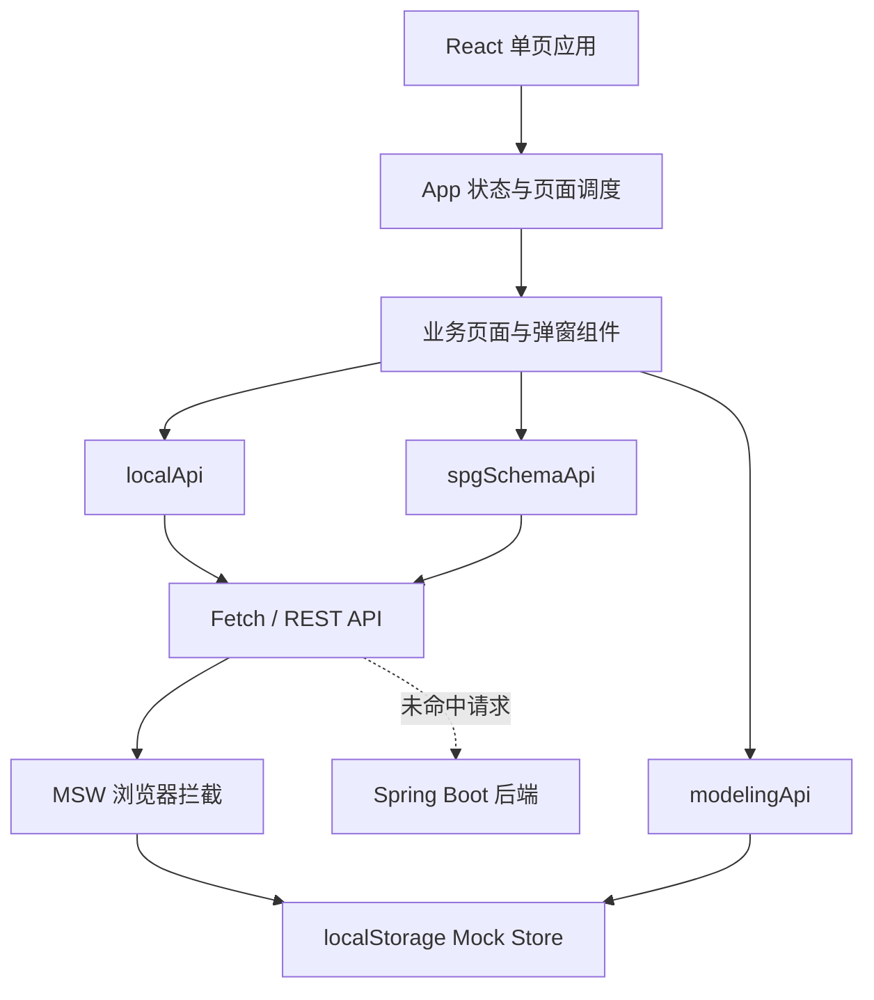

# 本体管理系统前端设计报告

> 项目：`kg-demo/front`  
> 报告日期：2026-09-18  
> 评审范围：当前前端源码、Mock 数据层、构建与部署配置、现有 Playwright 截图  
> 报告性质：现状总结与后续演进建议，不代表尚未实现的产品承诺

## 1. 执行摘要

本前端是一个面向数据治理与知识图谱建设人员的桌面优先型管理工作台，核心目标是把“数据接入、资产管理、元数据富化、本体建模、质量验证、模型交付”组织成连续的业务链路。

产品采用左侧分组导航、顶部多标签页、右侧主工作区的后台系统布局。整体视觉克制、信息密度较高，适合需要反复检索、对比和编辑结构化数据的专业用户。设计语言以蓝色为主操作色，以绿、橙、紫表达成功、提醒和类型差异，组件主要由统计区、表格、树、表单向导、详情弹窗、状态标签和图谱画布构成。

当前版本已具备较完整的演示闭环，但工程形态仍偏原型：页面集中在单个大型 JSX 文件中，没有前端路由和自动化测试，移动端隐藏侧栏后缺少替代导航，Mock Service Worker 在启动阶段无条件加载。若进入生产化阶段，应优先补齐导航可达性、环境隔离、错误状态和测试基线，再推进组件与领域模块拆分。

## 2. 产品定位与用户

### 2.1 产品定位

本体管理系统是一套数据资产与本体模型协同工作台，承担以下职责：

- 统一登记数据库、对象存储和第三方 API 等数据源。
- 通过采集任务把外部数据沉淀为可管理的数据资产。
- 通过模板和富化任务补充技术、业务与质量元数据。
- 使用 OWL/SPG 语义体系定义命名空间、类型、属性、关系、约束与规则。
- 对模型执行抽取、验证、问题处置、可视化及导入导出。
- 管理第三方应用凭证与调用记录，支撑外部系统集成。

### 2.2 目标用户

| 用户角色 | 核心目标 | 高频任务 |
| --- | --- | --- |
| 数据管理员 | 统一管理数据接入与资产目录 | 配置连接、创建目录、上传或移动资产、查看执行记录 |
| 元数据治理人员 | 建立元数据规范并执行富化 | 定义模板、创建富化任务、对比富化结果 |
| 本体建模人员 | 构建并维护领域语义模型 | 编辑类型与关系、版本切换、模型校验、问题处置 |
| 平台运维/集成人员 | 保障外部系统可靠调用 | 管理应用凭证、查看调用结果与失败原因 |

## 3. 信息架构

系统按业务域组织为五个一级分组，基础业务页面与建模页面合计约 39 个可打开页面入口。

| 一级分组 | 二级能力 | 页面/对象 |
| --- | --- | --- |
| 数据资产 | 资产组织、数据接入、采集执行 | 资产目录、连接配置、数据采集任务、采集执行记录 |
| 元数据治理 | 标准定义、元数据加工 | 元数据模版定义、元数据富化任务、元数据富化记录 |
| OWL 本体建模 | 建模、抽取、验证、交付 | 8 类核心元素、3 类智能抽取、2 类本体验证、2 类模型能力 |
| SPG Schema 建模 | 建模、抽取、验证、交付 | 与 OWL 分组共享同一套组件与数据能力，但保留独立导航入口 |
| 第三方管理 | 应用接入与审计 | 第三方应用、调用记录 |

建模域的 15 类能力包括：

- 本体建模：命名空间、实体类型、概念类型、事件类型、属性、约束、规则、关系。
- 智能抽取：结构化、半结构化、非结构化抽取。
- 本体验证：自动验证、问题处置。
- 本体模型：模型可视化、导入导出。

信息架构具有明确的业务分层，但 OWL 与 SPG 当前共享底层模型，用户看到的是两套入口、同一份数据。后续需要在产品定义上明确这是“不同视图/规范入口”，还是计划演进为真正隔离的两套模型，否则容易产生数据边界误解。

## 4. 核心业务流程

### 4.1 项目上下文

项目切换器位于品牌区下方，支持创建、重命名、删除和切换项目。项目切换后刷新所有项目数据，并清理当前详情、任务筛选和活动 Schema 等瞬态状态。所有主要资源通过 `projectId` 隔离。

### 4.2 数据资产闭环

用户先创建数据库、对象存储或第三方 API 连接，再配置采集范围与任务。任务执行后生成执行记录和资产文件，文件可在目录树中上传、拖拽移动、批量下载、查看详情或查看元数据关系图。

### 4.3 元数据治理闭环

用户通过向导定义元数据模板和字段规则，再选择资产范围创建富化任务。执行详情提供初始元数据与富化后元数据对比，便于判断加工质量和定位失败字段。

### 4.4 本体建模闭环

用户可以在版本上下文中维护八类本体元素；从不同数据形态预览候选元素并提交；运行验证规则、查看问题、记录处置结果；最后通过图谱查看模型结构，或以 CSV、OWL、模板文件完成交换。

## 5. 页面框架与交互模型

### 5.1 全局框架

- 左侧侧栏：承载品牌、项目上下文和分层业务导航，宽度约 238 px。
- 顶部标签栏：记录已打开页面，允许快速切换与关闭；资产目录为固定首页，不可关闭。
- 主内容区：默认全宽，桌面端使用 24-32 px 页面留白，承载页面标题、操作区、统计区和业务内容。
- 全局反馈：操作成功或失败通过右下角 Toast 短暂提示。

这种框架适合多任务后台操作，标签页降低了在复杂层级中反复回退的成本。但当前标签和页面只保存在 React 内存中，刷新后会回到资产目录，URL 也不能直接分享或恢复工作位置。

### 5.2 页面布局模式

| 模式 | 使用场景 | 设计特征 |
| --- | --- | --- |
| 统计卡 + 主列表 | 资产目录、验证总览 | 先展示关键指标，再进入具体对象 |
| 树 + 表格 | 资产目录、本体层级 | 左侧定位范围，右侧查看与批量操作 |
| 主从列表 | 数据源、Schema | 左侧选择对象，右侧展示详情和编辑入口 |
| 数据表格 | 任务、记录、第三方调用 | 紧凑行高、状态标签、行级操作、分页 |
| 分步向导 | 连接、采集、富化、模板 | 降低长表单认知负担，逐步校验输入 |
| 全屏/大弹窗 | 图谱、详情、问题处置 | 保持当前上下文，不打断主导航 |

### 5.3 交互原则

- 高频主操作使用蓝色实心按钮，次级操作使用描边或文本按钮。
- 删除等危险操作使用红色语义，但仍应确保所有删除均有明确确认反馈。
- 状态以颜色、文本和图标共同表达，避免只依赖颜色。
- 表格在窄屏下保留最小宽度并横向滚动，优先保证字段可读性。
- 资产目录支持拖拽移动，复杂编辑通过向导和弹窗完成。
- 图标统一使用 Lucide，减少视觉风格不一致。

## 6. 视觉设计系统

### 6.1 设计基调

界面采用冷白背景、浅灰分隔、深蓝文字和高明度蓝色强调，整体是安静、专业、偏工程工具的视觉方向。小圆角、轻描边和极弱阴影降低装饰感，适合长时间使用和高密度浏览。

### 6.2 核心设计变量

| 语义 | 当前值 | 用途 |
| --- | --- | --- |
| 主操作蓝 | `#1677ff` | 主按钮、选中态、链接、焦点态 |
| 标题深色 | `#172b4d` | 一级标题和关键数值 |
| 正文深色 | `#253858` | 正文和主要表格内容 |
| 次要文字 | `#6b7c93` | 描述、说明、辅助信息 |
| 分隔线 | `#e3eaf2` | 卡片、表格和区域边界 |
| 页面背景 | `#f3f6fa` | 主工作区背景 |
| 成功绿 | `#20a67a` | 正常连接、成功、通过 |
| 提醒橙 | `#e99a2b` | 处理中、警告、待办 |
| 类型紫 | `#8664d8` | 对象存储及类型区分 |

### 6.3 字体与层级

- 中文界面使用 `Noto Sans SC`，覆盖正文、标题和表单。
- 编码、标识符、版本号和数值使用 `IBM Plex Mono`，增强技术字段辨识度。
- 页面标题约 25-26 px；卡片标题约 14 px；正文与表格主要为 11-13 px。
- 紧凑字号符合专业工具定位，但 10 px 辅助文本较多，在低分辨率屏幕或缩放环境下可读性偏弱，建议将关键说明的下限提升到 11-12 px。

### 6.4 圆角、间距与密度

- 卡片、按钮和输入框主要使用 4-6 px 圆角。
- 页面级间距约 16-32 px，组件内部间距约 8-18 px。
- 表格行高约 38-62 px，针对对象复杂程度进行差异化处理。
- 卡片仅用于独立工具和数据单元，页面主体没有过度卡片嵌套。

## 7. 状态与反馈设计

当前界面已经覆盖以下状态：

- 空状态：无资产、无记录、无结果时提供文字说明和下一步入口。
- 连接状态：待测试、测试中、连接正常、连接失败。
- 任务状态：成功、失败、执行中及相关结果统计。
- 校验状态：错误、警告、提示，并展示命中数量和处置入口。
- 表单状态：选中、禁用、必填、聚焦与测试结果。
- 操作反馈：Toast、确认弹窗、详情弹窗和执行结果区。

仍需统一补充全局加载骨架、请求失败页、重试入口和超时提示。当前首次并行加载若出现异常，页面没有统一的可见错误边界。

## 8. 响应式设计

前端使用 1200、1080、960、720、680 px 等断点完成布局降级：统计区减少列数、双栏页面切换为单栏、表格开启横向滚动、表单网格折叠、弹窗适配视口宽高。

当前策略本质上是“桌面工作台 + 窄屏可查看”。在 680 px 以下，侧栏被直接隐藏，但没有汉堡菜单、抽屉导航或底部导航，导致移动端无法切换主要模块。这是当前最明确的响应式可用性缺口。建议产品明确是否支持手机端：

- 若支持，必须补充移动导航、触控尺寸、弹窗全屏化和关键表格的卡片/字段折叠方案。
- 若不支持，应明确最低支持宽度，并在过窄屏幕给出友好提示，而不是呈现无法导航的半成品体验。

## 9. 前端技术架构

### 9.1 技术栈

| 层级 | 当前方案 |
| --- | --- |
| UI 框架 | React + React DOM |
| 构建工具 | Vite |
| 图标 | Lucide React |
| 文件打包 | JSZip |
| 接口模拟 | MSW 2.x |
| 状态管理 | 组件内 `useState` / `useMemo` / `useEffect` |
| 数据请求 | 原生 `fetch` + 领域 API 模块 |
| 演示数据 | MSW + `localStorage` |
| 部署 | Node 构建，多阶段 Docker，Nginx 静态托管 |

### 9.2 代码组织

- `src/main.jsx`：应用入口、全局状态、导航、页面和主要业务组件。
- `src/styles.css`：全局变量、所有页面与组件样式、响应式规则。
- `src/services/localApi.js`：资产、连接、任务、模板、第三方应用等 API。
- `src/services/spgSchemaApi.js`：Schema 和核心本体元素读写。
- `src/services/modelingApi.js`：抽取、验证、问题处置、图谱和导入导出逻辑。
- `src/mocks`：MSW handler 与本地演示存储。

### 9.3 数据与环境策略

前端通过 `VITE_API_BASE_URL` 指定 API 地址；未配置时使用同源地址。Mock handler 复刻主要 REST 接口，并按项目隔离数据，适合独立演示和前后端并行开发。

目前 `bootstrap()` 会无条件启动 MSW，因此生产构建也会加载 Mock worker。虽然未匹配请求会放行，但已匹配接口会被浏览器端 Mock 接管，可能掩盖真实后端行为。建议使用明确环境开关，仅在开发或演示模式启动 MSW，并把所有 API 的真实/本地切换策略统一到同一配置层。

## 10. 可用性与无障碍评估

### 已具备

- 主要操作使用原生 `button`、`input`、`select`，基础键盘行为较好。
- 部分可交互行提供 `focus-visible` 样式。
- 标签关闭操作支持 Enter 和 Space，并提供 `aria-label`。
- 多级导航使用 `aria-expanded` 表达展开状态。
- 状态通常同时显示文字和颜色。

### 待完善

- 弹窗尚未形成统一的 `role="dialog"`、`aria-modal`、焦点圈定、关闭后焦点恢复与 Escape 关闭规范。
- 多个纯图标按钮需要逐项确认可访问名称和 Tooltip。
- 10 px 辅助文字较多，部分浅色文字的对比度需要通过 WCAG 工具实测。
- 资产拖拽需要提供键盘可完成的等价操作。
- 缺少 `prefers-reduced-motion` 适配。
- 移动端主导航不可达。

建议以 WCAG 2.2 AA 为目标，在组件化过程中同步建立键盘、焦点和语义属性规范。

## 11. 当前优势

1. 业务覆盖完整。数据接入、资产沉淀、元数据加工到本体交付形成了可演示闭环。
2. 信息架构贴合专业用户心智。按数据资产、元数据、本体和集成分域，复杂功能仍能被定位。
3. 视觉语言统一。颜色、字体、圆角、边框和密度具有较高一致性，符合工作台定位。
4. 复杂交互已有成熟雏形。树表联动、分步向导、版本切换、问题处置和图谱交互均有实现。
5. 演示独立性强。MSW 与本地存储让前端可以在后端不可用时完成核心流程展示。
6. 部署路径简单。Vite 静态产物通过 Nginx 提供，Docker 镜像结构清晰。

## 12. 风险与改进优先级

| 优先级 | 问题 | 影响 | 建议 |
| --- | --- | --- | --- |
| P0 | 680 px 以下侧栏隐藏且无替代导航 | 手机端无法切换模块 | 增加抽屉导航，或明确不支持并限制最小宽度 |
| P0 | MSW 在所有环境无条件启动 | 生产请求可能被 Mock 接管 | 仅在 `DEV` 或显式 `VITE_ENABLE_MSW=true` 时加载 |
| P0 | 缺少统一加载、失败与错误边界 | 接口异常时用户无法判断或恢复 | 建立页面请求状态模型、重试入口和 Error Boundary |
| P1 | `main.jsx` 约 3643 行、239 KB | 修改冲突与回归风险高 | 按领域页面、通用组件、Hooks 和状态层拆分 |
| P1 | `styles.css` 约 127 KB，规则追加较多 | 覆盖关系难追踪，视觉回归概率高 | 建立 token、基础组件和按领域样式模块 |
| P1 | 无前端路由与 URL 状态 | 无法深链、刷新恢复或分享页面 | 引入路由并把项目、页面、版本、筛选映射到 URL |
| P1 | 未发现测试脚本和测试文件 | 核心工作流缺乏回归保护 | 建立单元、组件与 Playwright 冒烟测试三层基线 |
| P1 | 生产构建主包约 548 KB、浏览器 Mock 包约 435 KB | 首次加载成本偏高，构建已触发 500 KB 分包告警 | 按领域动态加载页面，并从生产包排除 Mock 依赖 |
| P1 | 依赖版本使用 `latest` | 重装时结果不可预测 | 固定 React、Vite、Lucide 等依赖版本并制定升级节奏 |
| P2 | Google Fonts 依赖公网 | 内网环境字体加载失败或变慢 | 自托管字体或提供可靠系统字体栈 |
| P2 | 部分辅助文字偏小 | 可读性与无障碍风险 | 关键说明最小 11-12 px，并实测颜色对比度 |
| P2 | OWL 与 SPG 入口共享数据语义不透明 | 用户可能误解模型隔离关系 | 在产品文案与数据模型中明确二者关系 |

## 13. 建议实施路线

### 阶段一：可交付性加固

- 隔离开发 Mock 与生产 API。
- 增加全局加载、错误、超时和重试状态。
- 修复窄屏导航，完成关键弹窗的键盘与焦点规范。
- 固定依赖版本，建立构建、Lint 和最小 E2E 检查。

### 阶段二：架构拆分

- 引入前端路由，支持深链和刷新恢复。
- 按 `assets`、`metadata`、`modeling`、`integration` 四个领域拆分页面。
- 提取 Table、Modal、Wizard、StatusBadge、EmptyState、Pagination 等通用组件。
- 将异步请求、缓存、错误与刷新逻辑从根组件迁出。
- 将设计变量扩展为字号、间距、圆角、阴影、层级和交互状态 token。

### 阶段三：体验与质量提升

- 为核心角色建立任务型首页与最近访问。
- 支持筛选条件保存、批量操作和列表列配置。
- 为大型本体与图谱增加虚拟化、懒加载和性能监控。
- 建立视觉回归、无障碍扫描和真实后端契约测试。
- 根据真实使用数据决定手机端完整适配还是只支持平板与桌面。

## 14. 验收指标建议

| 方向 | 建议指标 |
| --- | --- |
| 可用性 | 核心任务成功率 >= 95%，关键流程无死路 |
| 性能 | 首屏 LCP <= 2.5 s，常用操作反馈 <= 200 ms |
| 稳定性 | 核心 E2E 流程通过率 100%，生产环境不加载 Mock worker |
| 无障碍 | 核心页面达到 WCAG 2.2 AA，无严重键盘阻断 |
| 响应式 | 声明支持的最小宽度下，所有一级功能均可导航 |
| 工程质量 | 页面按领域拆分，关键业务逻辑具备单元或集成测试 |

## 15. 结论

当前前端的最大价值是已经把复杂的数据治理与本体建模概念组织成了可操作、可演示、视觉一致的工作台。其产品结构和核心交互方向是成立的，尤其适合作为需求验证和业务演示基础。

下一阶段不宜继续只在现有大文件上叠加功能。应先完成环境隔离、错误处理、导航可达性、路由与测试基线，再进行领域化拆分。完成这些工作后，系统可以从“功能完整的演示前端”稳步演进为“可长期维护和生产交付的专业平台”。

## 附录：评审依据

- `src/main.jsx`：页面结构、导航、状态与主要交互。
- `src/styles.css`：视觉变量、组件样式和响应式断点。
- `src/services/*.js`：接口、建模、抽取、验证与图谱逻辑。
- `src/mocks/*.js`：接口模拟和本地存储策略。
- `package.json`、`Dockerfile`、`nginx.conf`：构建与部署方式。
- `output/playwright/*.png`：现有页面视觉结果抽查。
- `npm run build`：2026-09-18 验证通过；Vite 同时报告大于 500 KB 的分包告警。
