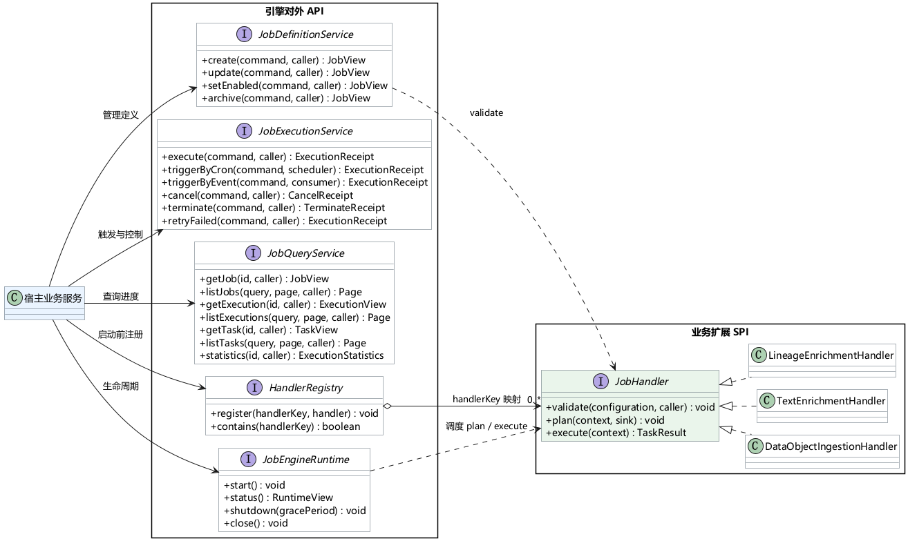
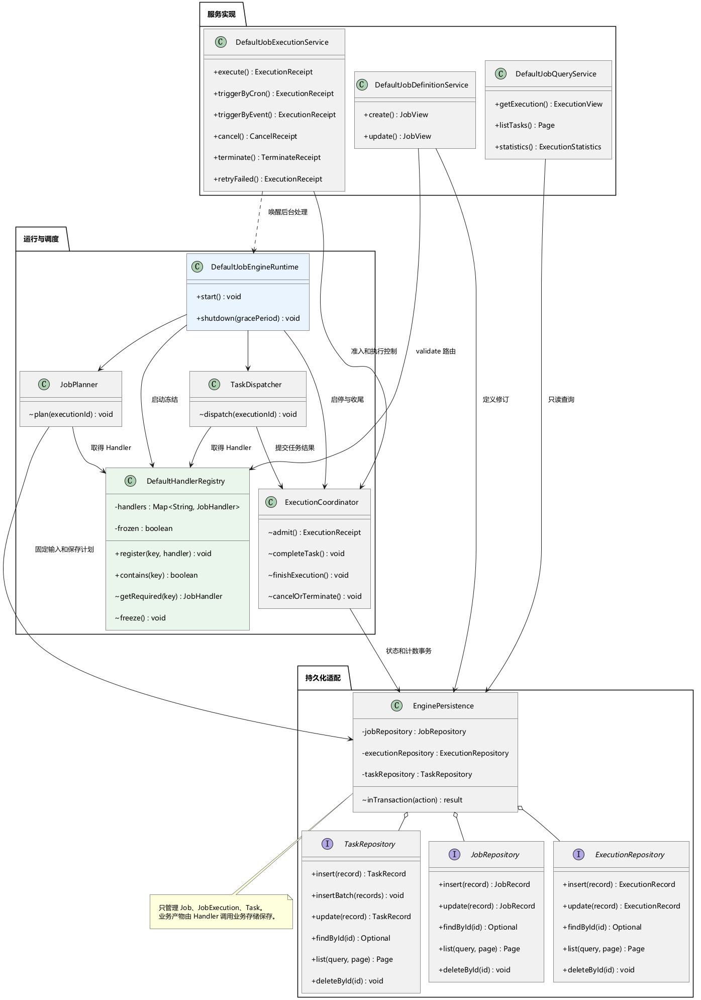
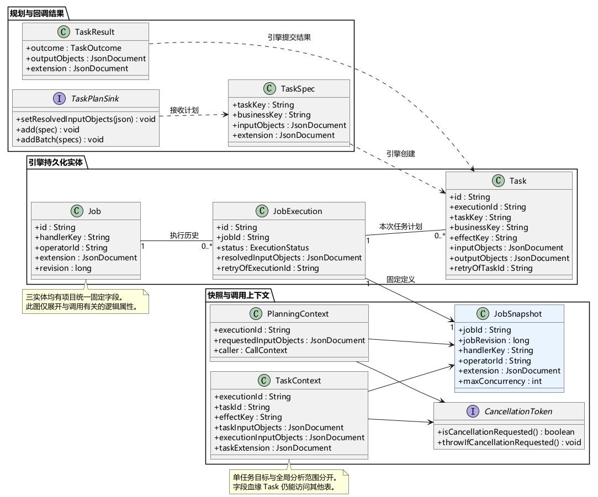
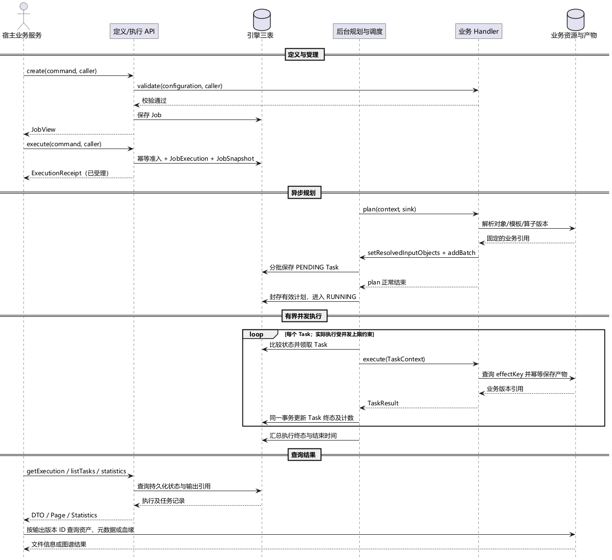

# Job Java 组件类图与应用调用模式

日期：2026-10-21  
状态：接口与接入设计稿  
适用场景：数据对象采集、文本富化、血缘富化

实现说明（2026-10-21）：Java 组件已落地在 `../../job-engine`，接入与测试以 [实现说明](../../job-engine/README.zh-CN.md) 为准。实体 ID 已从本设计稿中的 String 调整为雪花算法 long/BIGINT；当前采用单一 Maven JAR、JDBC 自管理事务，以及索引列加 JSON 快照的三表布局。下文模块拆分和 Bootstrap 为早期设计建议。

## 1. 设计约定

Job 引擎作为 Java 依赖嵌入宿主服务，直接负责 Job、JobExecution、Task 三张表的增删改查、事务和执行调度。宿主通过 Java API 调用引擎，实现并注册 JobHandler，由引擎在后台回调业务代码。页面所需的 HTTP 接口由宿主提供；宿主不直接操作这三张表。

Handler 使用进程内 Map 注册；每次启动重新装配业务对象。本文沿用已确认的五个对外接口，定时与事件方法使用最新命名 `triggerByCron`、`triggerByEvent`。采集场景用于说明组件扩展方式，不改变首版优先交付文本、血缘富化的安排。

### 1.1 核心概念

| 概念 | 定义 | 生命周期与归属 |
| --- | --- | --- |
| Job | 可重复运行的作业定义，保存 handlerKey、触发方式、并发配置及业务扩展 | 一份定义可以执行多次；配置修改只影响后续新执行 |
| JobExecution | Job 的某一次执行，保存本次定义快照、输入、统计和执行状态 | 每次新触发创建一条；重复的同一幂等请求返回原执行 |
| Task | 一次执行中的原子业务单元 | 属于一个 JobExecution；由 Handler 规划，由引擎调度 |
| JobHandler | 宿主实现的业务扩展接口，即 SPI | 校验业务配置、规划任务、执行任务，不自行更新引擎三表 |
| handlerKey | Job 到业务实现的路由标识，例如 metadata.text.v1 | 数据库保存字符串，内存 Map 保存标识到 Handler 对象的映射 |
| operatorId | 业务算子服务及版本的引用 | 不是 handlerKey；Handler 负责解析并调用算子 |
| requestKey | 调用方提供的一次操作的幂等标识 | 同 Job、同触发身份的重复请求不创建重复执行 |
| effectKey | 一次逻辑业务操作的幂等标识 | Task 首次生成，失败任务重试时继承，用于复用已提交的业务结果 |

Job、JobExecution、Task 是三种持久化实体；实际执行是“作业执行、原子任务”两级。Task 没有独立的触发入口，宿主通过 JobExecution 控制和查询它。

### 1.2 职责划分

| 层次 | 职责 |
| --- | --- |
| 宿主业务服务 | 身份与权限、单位项目上下文、前端接口、依赖装配、事件消费、调用引擎 |
| 引擎组件 | 三表读写、触发幂等、定义快照、任务规划接收、并发调度、状态统计、取消和终止 |
| 业务 Handler | 文件及目录解析、连接访问、模板验证、算子调用、任务粒度选择、业务产物保存 |
| 业务资源服务 | 连接凭证解析、对象存储、数据对象、原生元数据、模板、元数据版本、血缘版本和图谱查询 |

本版每个数据库隔离域只有一个活跃引擎调度实例，同一 Job 同时最多一个未终态执行。不同 Job 可以并行；每次执行内的并发同时受 Job 配置和全局线程上限约束。

### 1.3 JAR 组件边界与装配方式

组件以 JAR 形式被其他 Java 服务依赖，建议按以下边界组织：

| 模块 | 内容 | 是否由宿主实现 |
| --- | --- | --- |
| `job-engine-api` | 五个对外服务接口、Command、View、Receipt、Handler SPI | 否，作为稳定调用契约 |
| `job-engine-core` | 定义服务、执行服务、查询服务、规划、调度、状态机和三表事务编排 | 否，引擎提供实现 |
| `job-engine-jdbc`（名称可调整） | Job、JobExecution、Task 的 SQL Repository、分页查询和数据库方言适配 | 否，引擎提供默认实现；宿主提供数据源 |
| 业务扩展模块 | 采集、文本富化、血缘富化 Handler，以及业务产物访问 | 是，由宿主实现并注册 |

宿主负责提供 `DataSource`、事务管理器和业务资源服务；JAR 内部通过 Repository 对三张表执行 SQL。若宿主使用其他存储介质，只需替换 `JobRepository`、`ExecutionRepository`、`TaskRepository` 适配器，不改变上层服务和 Handler 契约。引擎可以提供建表脚本或迁移脚本，但运行期间的表读写必须经过引擎事务边界。

## 2. 类图

### 2.1 对外接口与业务扩展



[可编辑 PlantUML 图源](assets/job-engine-class-and-usage/public-and-handler-classes.puml)

图中的三个 Handler 由宿主实现。DataObjectIngestionHandler 处理采集，TextEnrichmentHandler 处理文本富化，LineageEnrichmentHandler 处理血缘富化；它们使用同一个 JobHandler 契约。

### 2.2 引擎内部协作



[可编辑 PlantUML 图源](assets/job-engine-class-and-usage/engine-internal-classes.puml)

下表中的实现类是建议的内部拆分，不增加宿主必须调用的服务接口。

| 类或接口 | 职责 |
| --- | --- |
| DefaultJobDefinitionService | 管理定义，调用 Handler.validate，保存修订后的 Job |
| DefaultJobExecutionService | 接受手工、定时、事件和重试请求；执行幂等与准入；处理取消、终止 |
| DefaultJobQueryService | 查询三种实体，返回 DTO、分页和统计 |
| DefaultJobEngineRuntime | 管理启动、关闭、后台调度与遗留执行处理 |
| DefaultHandlerRegistry | 使用内存 Map 保存业务实现；检查重复 key；启动时冻结注册表 |
| JobPlanner | 查找 Handler，固定输入并接收 Task 计划；计划完成前不派发任务 |
| TaskDispatcher | 在并发限制内领取 Task，调用 Handler.execute，处理返回值和异常 |
| ExecutionCoordinator | 协调状态比较更新、任务计数和执行收尾，避免取消与完成竞争 |
| EnginePersistence | 聚合三种 Repository 与同一数据库事务能力，供内部服务及调度使用；所有三表写入从这里进入 |
| JobRepository / ExecutionRepository / TaskRepository | 分别负责三表的 insert、update、find、list 和受控 delete，由 JAR 的数据库适配器实现 |

### 2.3 实体与执行上下文



[可编辑 PlantUML 图源](assets/job-engine-class-and-usage/entity-and-context-classes.puml)

| 类型 | 关键内容 |
| --- | --- |
| JobSnapshot | 受理时固定的 Job 修订、handlerKey、operatorId、业务扩展和本次有效并发；不跟随定义变化 |
| PlanningContext | executionId、JobSnapshot、原始请求输入、CallContext、取消令牌 |
| TaskSpec | Handler 规划的 taskKey、businessKey、名称、输入引用和业务扩展 |
| TaskContext | executionId、taskId、taskKey、effectKey、JobSnapshot、本 Task 输入、执行全局输入、扩展和取消令牌 |
| TaskResult | SUCCESS 或 SKIPPED、输出对象引用、附加业务结果；失败通过异常表达 |
| TaskPlanSink | 接收一次性固定输入和分批任务计划，将计划写入引擎存储 |
| CancellationToken | 暴露取消或终止意图，由 Handler 在适当的业务边界检查 |

JobExecution 与 Task 在规划过程中可以暂时为 1:0；有效计划封存后为 1:N。重试创建新的 JobExecution 和 Task，分别用 retryOfExecutionId、retryOfTaskId 关联原记录。

taskKey 是一次执行内唯一的任务键，例如 `lineage-sales-summary-v1-total_amount`，用于避免重复提交任务计划；businessKey 是业务聚合键，本例使用 fileId，同一文件的多个字段任务可以共享它。taskId 由引擎生成，是持久化记录标识；effectKey 用于业务产物幂等，重试时保持不变。

## 3. 对外接口与 SPI 定义

### 3.1 对外 Java API

```java
public interface JobDefinitionService {
    JobView create(CreateJobCommand command, CallContext caller);
    JobView update(UpdateJobCommand command, CallContext caller);
    JobView setEnabled(SetJobEnabledCommand command, CallContext caller);
    JobView archive(ArchiveJobCommand command, CallContext caller);
}

public interface JobExecutionService {
    ExecutionReceipt execute(RunJobCommand command, CallContext caller);
    ExecutionReceipt triggerByCron(CronTriggerCommand command, CallContext scheduler);
    ExecutionReceipt triggerByEvent(EventTriggerCommand command, CallContext consumer);
    CancelReceipt cancel(CancelExecutionCommand command, CallContext caller);
    TerminateReceipt terminate(TerminateExecutionCommand command, CallContext caller);
    ExecutionReceipt retryFailed(RetryFailedCommand command, CallContext caller);
}

public interface JobQueryService {
    JobView getJob(String jobId, CallContext caller);
    Page<JobView> listJobs(JobQuery query, PageRequest page, CallContext caller);
    ExecutionView getExecution(String executionId, CallContext caller);
    Page<ExecutionView> listExecutions(ExecutionQuery query, PageRequest page, CallContext caller);
    TaskView getTask(String taskId, CallContext caller);
    Page<TaskView> listTasks(TaskQuery query, PageRequest page, CallContext caller);
    ExecutionStatistics statistics(String executionId, CallContext caller);
}

public interface HandlerRegistry {
    void register(String handlerKey, JobHandler handler);
    boolean contains(String handlerKey);
}

public interface JobEngineRuntime extends AutoCloseable {
    void start();
    RuntimeView status();
    void shutdown(Duration gracePeriod);
    void close();
}
```

| 接口 | 宿主的使用方式 |
| --- | --- |
| JobDefinitionService | 保存和修改可重复运行的配置；创建定义不立即执行；停用不取消在途执行；归档保留历史 |
| JobExecutionService | 触发一次执行或控制某一次执行；触发返回 ExecutionReceipt，不同步等待整个业务完成 |
| JobQueryService | 查看定义、执行历史、Task 明细及统计；通过 Task 输出引用访问业务结果 |
| HandlerRegistry | 在引擎启动前注册实现；contains 只检查注册情况，不是外部服务健康检查 |
| JobEngineRuntime | 宿主启动时 start，退出时 shutdown 或 close；status 查看整个实例的状态 |

### 3.2 三表持久化 CRUD 服务

五个对外服务是面向业务语义的 API；三张表的底层增删改查由 JAR 内部的 Repository 和 `EnginePersistence` 完成。宿主不直接注入 Repository，也不绕过引擎写表。下面是持久化端口的建议定义，具体 `Record` 可由 JDBC、MyBatis 或其他数据库适配器实现。

```java
public interface JobRepository {
    JobRecord insert(JobRecord record);
    JobRecord update(JobRecord record);
    Optional<JobRecord> findById(String jobId);
    Page<JobRecord> list(JobQuery query, PageRequest page);
    void deleteById(String jobId); // 仅允许归档且无历史引用的维护场景
}

public interface ExecutionRepository {
    ExecutionRecord insert(ExecutionRecord record);
    ExecutionRecord update(ExecutionRecord record);
    Optional<ExecutionRecord> findById(String executionId);
    Page<ExecutionRecord> list(ExecutionQuery query, PageRequest page);
    void deleteById(String executionId); // 仅允许受控清理场景
}

public interface TaskRepository {
    TaskRecord insert(TaskRecord record);
    void insertBatch(List<TaskRecord> records);
    TaskRecord update(TaskRecord record);
    Optional<TaskRecord> findById(String taskId);
    Page<TaskRecord> list(TaskQuery query, PageRequest page);
    void deleteById(String taskId); // 仅允许受控清理场景
}
```

`insert` 用于创建 Job、执行记录和计划任务；`update` 用于状态机、计数、时间戳、错误信息及结果引用；`find/list` 用于服务查询和后台领取；`deleteById` 不属于正常业务流程，只用于数据保留期到期后的维护清理，并必须经过外键、终态和权限校验。正常的 Job 删除通过 `archive` 实现逻辑删除，以保留执行历史；执行和 Task 默认只允许终态后归档清理，不能在运行中物理删除。

Repository 只在 `EnginePersistence.inTransaction(...)` 提供的事务上下文中执行写操作。执行准入、Job 快照保存、Task 批量写入、Task 终态更新和执行统计收尾分别使用短事务；不在数据库事务内调用外部算子或文件系统。三表的通用固定字段（ID、创建/更新时间、版本、状态等）由引擎统一写入，`extension` 和业务 JSON 由业务 Handler 提供但由引擎校验大小和序列化格式。

### 3.3 JAR 宿主装配示例

以下是宿主服务使用 JAR 的建议方式。`JobEngineBootstrap` 是组件装配门面，名称可按最终实现调整；示例表达依赖关系，不代表 REST 接口。

```java
JobEngineComponents engine = JobEngineBootstrap.builder()
        .dataSource(dataSource)
        .transactionManager(transactionManager)
        .businessServices(businessServices)
        .build();

engine.handlerRegistry().register("metadata.text.v1", textEnrichmentHandler);
engine.handlerRegistry().register("metadata.lineage.v1", lineageEnrichmentHandler);
engine.handlerRegistry().register("data.ingestion.v1", ingestionHandler);
engine.runtime().start();

JobView job = engine.jobDefinitionService().create(createJobCommand, caller);
ExecutionReceipt receipt = engine.jobExecutionService()
        .execute(runJobCommand(job.id()), caller);
Page<TaskView> tasks = engine.jobQueryService()
        .listTasks(TaskQuery.byExecution(receipt.executionId()), page, caller);
```

应用关闭时先调用 `engine.runtime().shutdown(gracePeriod)`，再释放宿主自己的数据源；`JobEngineComponents.close()` 可作为统一关闭入口。一个 JVM 内只应为同一数据库隔离域创建一个运行时实例，避免重复调度同一 Job。

### 3.4 Handler SPI

```java
public interface JobHandler {
    void validate(JobConfiguration configuration, CallContext caller);
    void plan(PlanningContext context, TaskPlanSink sink) throws Exception;
    TaskResult execute(TaskContext context) throws Exception;
}

public interface TaskPlanSink {
    void setResolvedInputObjects(JsonDocument inputObjects);
    void add(TaskSpec specification);
    void addBatch(List<TaskSpec> specifications);
}

public interface CancellationToken {
    boolean isCancellationRequested();
    void throwIfCancellationRequested();
}

public record TaskSpec(
        String taskKey, String businessKey, String name,
        JsonDocument inputObjects, JsonDocument extension) {}

public record TaskResult(
        TaskOutcome outcome,
        JsonDocument outputObjects, JsonDocument extension) {}
```

| 回调 | 调用方与时机 | 业务实现需要完成的工作 |
| --- | --- | --- |
| validate | 定义服务在创建或更新配置时调用 | 检查必要业务引用、配置组合及当前访问权限；执行时仍需处理资源失效和权限变化 |
| plan | JobExecution 进入规划阶段后，由 JobPlanner 调用 | 解析实际输入和业务版本，先 setResolvedInputObjects，再逐批 add；正常返回后封存计划 |
| execute | Task 被领取后，由 TaskDispatcher 调用 | 使用固定输入执行业务，以 effectKey 幂等保存产物，返回产物引用 |

JsonDocument 表示不可变 JSON 值。inputObjects、outputObjects 的根为数组，extension 的根为对象；大范围输入使用不可变 manifest 引用。Handler 必须支持多 Task 并发调用。

### 3.5 内存 Map 注册模式

宿主获得的是 HandlerRegistry 接口；引擎内部使用 DefaultHandlerRegistry 查找实现。`getRequired(handlerKey)` 和 `freeze()` 是实现类的内部方法，不加入对外 HandlerRegistry 接口。

| 操作 | 规则 |
| --- | --- |
| register | 检查非空 key 与实现；重复 key 拒绝，不覆盖；冻结后拒绝新增 |
| contains | 检查 key 是否存在 |
| getRequired | 内部按 JobSnapshot.handlerKey 取得实现；不存在则记录 HANDLER_NOT_FOUND |
| freeze | start 时冻结注册关系；与 register 使用同一同步机制，避免检查与写入之间的竞争 |
| 重启装配 | 重新构造 Handler 与 Map，再启动引擎；数据库仅保存 handlerKey |

Map 可使用 ConcurrentHashMap，但它只保证容器读写安全，注册冻结仍需同步控制；Handler 自身的线程安全也由业务实现保证。版本键一旦用于执行，其语义需保持稳定；升级实现使用新 key，并按历史重试保留旧版本实现。

## 4. 通用应用模式

### 4.1 装配与启动

以下为调用示意，registry、runtime、definitions、executions、queries 和业务依赖由宿主装配注入；Command 的完整字段参见后续场景示例。

```java
registry.register("data.ingestion.v1", ingestionHandler);
registry.register("metadata.text.v1", textHandler);
registry.register("metadata.lineage.v1", lineageHandler);

runtime.start();

JobView job = definitions.create(createJobCommand, caller);
ExecutionReceipt receipt = executions.execute(
        new RunJobCommand(job.id(), requestKey, inputObjects, null), caller);

ExecutionView execution = queries.getExecution(receipt.executionId(), caller);
ExecutionStatistics progress = queries.statistics(receipt.executionId(), caller);
Page<TaskView> tasks = queries.listTasks(taskQuery, pageRequest, caller);
```

taskQuery 必须携带 receipt.executionId。receipt 表示已受理；规划与执行在后台进行，宿主通过查询接口刷新页面。应用关闭时调用 `runtime.shutdown(gracePeriod)`；close 使用配置的默认宽限期，不关闭宿主共享的 DataSource。

### 4.2 通用执行时序



[可编辑 PlantUML 图源](assets/job-engine-class-and-usage/common-execution-sequence.puml)

受理事务只保存执行记录和定义快照，不跨数据库事务调用外部算子。规划期间可以分批保存 Task，但只有固定输入、全部计划写入成功且任务数量大于零后，才允许开始调度。失败任务重试使用已经固定的计划，跳过 plan。

### 4.3 三种触发调用

| 触发方式 | 调用入口 | 谁负责触发与输入 | 幂等身份 |
| --- | --- | --- | --- |
| 手工 | execute(RunJobCommand, caller) | 宿主响应用户操作，传 jobId、requestKey、输入引用 | Job + MANUAL + requestKey |
| 定时 | triggerByCron(CronTriggerCommand, scheduler) | 定时适配器传 jobId、scheduledTime、scheduleRevision；Handler 使用定义中的默认输入范围 | Job + CRON + 计划时刻 + 定义修订号 |
| 事件 | triggerByEvent(EventTriggerCommand, consumer) | 宿主消费事件，传来源、事件 ID、类型及 payload；Handler 将事件解析为实际输入 | Job + EVENT + eventSource + eventId |

CRON 使用含秒六段表达式及显式时区，错过不追补，Job 忙时跳过本次触发。事件消费者在受理回执成功后确认消息；JOB_BUSY 等可重试错误由宿主保留消息重试。事件确认表示引擎已受理，不代表富化已经成功。

本文三类 Handler 约定：手工输入非空时使用本次选择；输入为空时解析 Job.extension.business.selection；两者都没有时拒绝空计划。事件输入信封由引擎保存，Handler 从 payload 解析选择范围。每次新执行都重新解析选择器，然后冻结本次实际对象及版本。

### 4.4 定义、执行与业务产物的边界

| 保存位置 | 典型内容 |
| --- | --- |
| Job 独立字段 | handlerKey、operatorId、触发配置、并发上限、启用状态 |
| Job.extension.business | 模板 ID、连接配置 ID、存储目录 ID、默认选择范围、血缘任务粒度策略 |
| JobExecution.jobSnapshot | 受理时的定义配置；规划解析出的模板版本等另存于固定执行输入/manifest |
| JobExecution.resolvedInputObjects | 本次完整分析范围、确切对象版本、模板/算子版本或其 manifest 引用 |
| Task.inputObjects / extension.business | 本 Task 的目标对象或字段，以及业务拆分参数 |
| Task.outputObjects | 数据对象、元数据版本或血缘版本的引用；不存完整图谱 |
| 业务存储 | 对象实际内容、原生字段、富化 JSON、血缘关系、SQL 等附属物 |

模板、算子、输入对象的可变别名必须在实际业务执行前解析为明确版本，并供重试复用；不能仅保存一个随时指向“最新”的地址。连接配置保存引用，实际凭证在调用时由宿主受控解析。

## 5. 数据对象采集模式

### 5.1 定义与任务粒度

DataObjectIngestionHandler 负责从指定连接读取源对象，写入平台资产存储并登记数据对象。连接配置和目标目录保存在业务扩展；目标资产级别由宿主校验，项目和单位上下文取可信调用身份。

| 项目 | 示例约定 |
| --- | --- |
| handlerKey | data.ingestion.v1 |
| Job.type | INGESTION |
| 必要配置 | connectionConfigId、storageDirectoryId、assetLevel |
| 输入 | 源文件、源表等可识别对象；目录选择在 plan 时枚举成确定对象清单 |
| Task 粒度 | 本例每个源文件一个 Task；数据库场景可每张表一个 Task |
| 输出 | DATA_OBJECT 引用，可附原生元数据版本、SQL/查询计划等附件引用 |

### 5.2 定义与调用输入示例

以下 JSON 说明 Java Command 的字段内容，definition 对应 CreateJobCommand，run 对应 RunJobCommand；不是 REST 请求。

```json
{
  "definition": {
    "name": "销售资料采集",
    "type": "INGESTION",
    "handlerKey": "data.ingestion.v1",
    "triggerType": "MANUAL",
    "maxConcurrency": 3,
    "isEnable": true,
    "extension": {
      "schemaVersion": 1,
      "business": {
        "connectionConfigId": "conn-object-store-01",
        "storageDirectoryId": "dir-sales",
        "assetLevel": "PROJECT"
      }
    }
  },
  "run": {
    "jobId": "job-ingestion-01",
    "requestKey": "ingestion-request-001",
    "inputObjects": [
      { "kind": "SOURCE_OBJECT", "objectKey": "sales/sales_detail.csv", "sourceVersion": "s101" },
      { "kind": "SOURCE_OBJECT", "objectKey": "sales/sales_summary.csv", "sourceVersion": "s102" },
      { "kind": "SOURCE_OBJECT", "objectKey": "sales/report.pdf", "sourceVersion": "s103" }
    ]
  }
}
```

### 5.3 Handler 调用流程

| 阶段 | 业务处理 |
| --- | --- |
| validate | 校验连接配置、目标目录、写入权限和资产级别，不把凭证写入 Job |
| plan | 枚举三个源文件，固定 objectKey、源版本及目标目录，调用 setResolvedInputObjects，再生成三个 TaskSpec |
| execute | 取得源内容，校验源版本，写入对象存储，登记数据对象，解析可识别的原生字段，以 effectKey 幂等发布资产 |
| 查询 | 宿主 listTasks 查看三个文件的执行结果；根据 DATA_OBJECT 引用查询文件与目录信息，实现“跳转所在目录” |

| Task | 输入 | 业务产物 |
| --- | --- | --- |
| ingest-sales-detail | sales_detail.csv@s101 | sales-detail@v1，结构化，原生字段包括 region、amount |
| ingest-sales-summary | sales_summary.csv@s102 | sales-summary@v1，结构化，原生字段包括 region、total_amount |
| ingest-report | report.pdf@s103 | sales-report@v1，非结构化，包含文件基础属性 |

单个 Task 的输出示例：

```json
[
  {
    "kind": "DATA_OBJECT",
    "fileId": "sales-detail",
    "fileVersionId": "sales-detail-v1",
    "directoryId": "dir-sales",
    "metadataType": "STRUCTURED",
    "assetLevel": "PROJECT",
    "nativeMetadataVersionId": "native-sales-detail-v1"
  }
]
```

fileId 表示逻辑对象，fileVersionId 表示本次确定版本；示例中的 kind、metadataType 是业务 JSON 契约建议，不新增引擎枚举。数据库表采集产生的 SQL 或查询计划可作为 output 附件引用保存。

结构化数据的标准元数据与原生字段在采集或上传解析后即可查看，不依赖富化。无法提供源版本或快照的连接不能承诺跨重试内容一致：可校验失败并要求重新采集，或者由业务显式选择“读取当前内容”的策略并记录实际指纹。

## 6. 文本富化模式

### 6.1 定义与调用输入示例

TextEnrichmentHandler 根据模板与算子，为每个确定版本的数据对象产生元数据版本。结构化和非结构化数据都可以参与文本富化。

```json
{
  "definition": {
    "name": "销售资料文本富化",
    "type": "ENRICH_TXT",
    "handlerKey": "metadata.text.v1",
    "triggerType": "MANUAL",
    "operatorId": "operator-text-v2",
    "maxConcurrency": 3,
    "extension": {
      "schemaVersion": 1,
      "business": { "metadataTemplateId": "template-sales-v3" }
    }
  },
  "run": {
    "jobId": "job-text-01",
    "requestKey": "text-request-001",
    "inputObjects": [
      { "kind": "FILE", "fileId": "sales-detail", "fileVersionId": "sales-detail-v1" },
      { "kind": "FILE", "fileId": "sales-summary", "fileVersionId": "sales-summary-v1" },
      { "kind": "FILE", "fileId": "sales-report", "fileVersionId": "sales-report-v1" }
    ]
  }
}
```

### 6.2 Handler 调用流程

| 阶段 | 业务处理 |
| --- | --- |
| validate | 校验 operatorId、metadataTemplateId、模板字段和可用性 |
| plan | 固定三个文件版本、模板版本、原生字段过滤策略和算子版本，再按文件生成三个 Task |
| execute | 读取该文件及模板，通过算子生成模板字段值，幂等保存元数据版本容器和 JSON 结果，返回 METADATA_VERSION 引用 |
| 查询 | 每个文件一行列出 Task，显示起止时间与状态；“查看孵化结果”读取该文件的元数据版本 |

| Task | 单任务输入 | 输出 |
| --- | --- | --- |
| text-sales-detail-v1 | sales-detail-v1 | metadata-text-detail-v1 |
| text-sales-summary-v1 | sales-summary-v1 | metadata-text-summary-v1 |
| text-sales-report-v1 | sales-report-v1 | metadata-text-report-v1 |

```json
[
  {
    "kind": "METADATA_VERSION",
    "fileId": "sales-report",
    "fileVersionId": "sales-report-v1",
    "metadataVersionId": "metadata-text-report-v1"
  }
]
```

业务元数据版本保存模板、算子、输入文件版本及来源 Task 的关联。原生字段按模板的全部保留、部分保留或完全不纳入策略展示，模板富化新增字段始终展示，并区分字段来源标签。文本富化本次产物不包含血缘；业务综合图谱可另行合并其他已存在的血缘版本。

## 7. 血缘富化模式

### 7.1 定义与调用输入示例

LineageEnrichmentHandler 对确定的全局对象集合分析上游与锚点关系，不要求 metadataTemplateId。本文以表级拆分为例，字段级拆分由业务按数据量和算子能力选择。

```json
{
  "definition": {
    "name": "销售资料血缘富化",
    "type": "ENRICH_LIN",
    "handlerKey": "metadata.lineage.v1",
    "triggerType": "MANUAL",
    "operatorId": "operator-lineage-v1",
    "maxConcurrency": 2,
    "extension": {
      "schemaVersion": 1,
      "business": { "granularity": "TABLE" }
    }
  },
  "run": {
    "jobId": "job-lineage-01",
    "requestKey": "lineage-request-001",
    "inputObjects": [
      { "kind": "FILE", "fileId": "sales-detail", "fileVersionId": "sales-detail-v1" },
      { "kind": "FILE", "fileId": "sales-summary", "fileVersionId": "sales-summary-v1" },
      { "kind": "FILE", "fileId": "sales-report", "fileVersionId": "sales-report-v1" },
      { "kind": "EVIDENCE", "objectUri": "object://evidence/sales-summary-build-v1.sql" },
      { "kind": "EVIDENCE", "objectUri": "object://evidence/sales-report-build-v1.json" }
    ]
  }
}
```

### 7.2 全局输入与单任务输入

plan 先固定全部文件、原生元数据定义和证据版本，保存为 executionInputObjects；再按每个目标表或字段规划 Task。单任务只锚定一个分析目标，但 execute 同时获得 TaskContext.executionInputObjects，能够读取其他表和字段。

| 拆分方式 | 单任务负责范围 | 适用说明 |
| --- | --- | --- |
| TABLE | 一张目标表的对象级血缘及其原生字段血缘 | 对结构化对象按表分析；整表字段作为一个业务工作单元 |
| FIELD | 一张表中的一个目标原生字段 | 字段引用需要文件版本及 metadataDefinitionId；同一表可生成多个 Task |
| OBJECT | 一个非结构化数据对象的对象级血缘 | 对非结构化对象使用，不生成该对象的字段级元数据富化结果 |

granularity=TABLE 表示结构化目标按表拆分；本例非结构化目标仍由 Handler 派生 OBJECT Task。所有选定目标都应生成任务并分析；没有发现上游关系的对象，可以成功发布空关系结果，并记录分析完成，不能等同于执行失败。

| Task | 锚定目标 | 可读取范围 | 本例结果 |
| --- | --- | --- | --- |
| lineage-sales-detail-v1 | sales-detail-v1，TABLE | 全部三个对象、字段与证据 | 已分析，未发现本范围内上游 |
| lineage-sales-summary-v1 | sales-summary-v1，TABLE | 全部三个对象、字段与证据 | 对象级及字段级关系 |
| lineage-sales-report-v1 | sales-report-v1，OBJECT | 全部三个对象与证据 | 只包含数据对象关系 |

### 7.3 两种血缘结果

假设 SQL 证据明确记录汇总对象由以下查询产生：

```sql
SELECT region, SUM(amount) AS total_amount
FROM sales_detail
GROUP BY region;
```

| 血缘类型 | 上游 | 锚定端 | 证据与含义 |
| --- | --- | --- | --- |
| 数据对象血缘 | sales-detail-v1 | sales-summary-v1 | 查询生成记录证明汇总对象来自明细对象 |
| 元数据血缘 | sales-detail-v1 的 amount 字段定义 | sales-summary-v1 的 total_amount 字段定义 | 表达式 SUM(amount)；字段端点必须携带对象版本及元数据定义 ID |
| 数据对象血缘 | sales-summary-v1 | sales-report-v1 | 报告发布记录证明 PDF 由汇总对象生成 |

非结构化 PDF 的本次结果只包含 DATA_OBJECT 关系；结构化表可包含对象级关系和原生字段级关系。血缘版本保存锚点、上游引用、表达式和证据来源，不覆盖原生元数据，也不产生文本模板字段。仅有字段同名、外键关系或统计相关性时，不能直接宣称存在已确认的数据生成血缘。

```json
[
  {
    "kind": "LINEAGE_VERSION",
    "fileId": "sales-summary",
    "fileVersionId": "sales-summary-v1",
    "lineageVersionId": "lineage-sales-summary-v1"
  }
]
```

每个 Task 按自己的表、字段或对象范围发布独立结果，并保存来源执行和 Task。字段级并行分析应按字段锚点区分版本容器，由业务图谱服务组合查询，避免多个任务互相覆盖整表结果。

## 8. 三种场景对照与结果查询

| 维度 | 数据对象采集 | 文本富化 | 血缘富化 |
| --- | --- | --- | --- |
| 核心目的 | 将源对象纳入资产目录 | 生成模板定义的元数据字段 | 识别并保存上游到锚点的关系 |
| 输入 | 源文件、源表、目录选择器 | 已有数据对象版本 | 全局对象集合、原生字段与证据 |
| 模板 | 不要求富化模板 | 必须指定 | 不要求 |
| 算子 | 按连接业务需要决定 | 必须指定 | 必须指定 |
| 任务粒度 | 文件或源表 | 一个文件一个 Task | 表、字段或非结构化对象 |
| 输出引用 | DATA_OBJECT | METADATA_VERSION | LINEAGE_VERSION |
| 图谱变化 | 标准元数据及可解析原生字段可见 | 增加模板字段，本次不增加血缘 | 增加对象级或字段级血缘 |
| 页面行 | 被采集的源对象及生成资产 | 被富化文件 | 分析目标及粒度；字段级可同文件多行 |

引擎查询和图谱查询是两条调用链：先用 JobQueryService 查看执行统计与 Task 清单，再由宿主根据 Task.outputObjects 中的业务版本 ID 调用元数据或血缘服务。图谱页面可合并原生字段、模板新增字段、血缘关系并标注类型；左图右表联动由前端处理。

文件视角的清单由宿主按 businessKey/fileId 聚合展示。文本富化天然一文件一行；字段级血缘可能一文件多个 Task，应提供展开明细，不能把 Task 数当文件数。ExecutionStatistics 是任务统计，采集字节数、文件数、元数据字段数和血缘边数属于业务统计。

## 9. 取消、终止与失败重试的调用模式

| 操作 | 宿主调用 | 引擎与 Handler 的行为 |
| --- | --- | --- |
| 停用定义 | definitions.setEnabled(command, caller) | 只阻止新触发，在途执行继续 |
| 取消执行 | executions.cancel(command, caller) | 停止派发，取消待执行 Task，通知运行 Handler；等业务退出后收尾 |
| 终止执行 | executions.terminate(command, caller) | 封闭引擎状态并拒绝迟到提交；不能承诺外部算子调用已停止或业务数据已回滚 |
| 重试失败任务 | executions.retryFailed(command, caller) | 原执行需已终态；创建新执行，复制指定 FAILED Task、固定输入与快照，继承 effectKey，不重新 plan |

重试要求当前 Job 已启用、未归档、没有在途执行，原 handlerKey 仍可用。单纯网络错误不代表业务结果一定没落库；Handler 应先用 effectKey 查找已有产物，存在则返回原引用，不存在才重新执行。采集按源版本与目标版本去重，文本按原模板与算子版本复用，血缘按原全局范围和锚点复用。

引擎三表事务与业务结果写入不天然构成跨资源原子事务。重启时将无法继续的非终态执行及任务标记为 TERMINATED，并保留原因；本版不自动重放外部业务。关闭时先停止准入，等待在途执行，再按超时策略终止并释放资源。

## 10. 宿主接入清单

1. 引入 `job-engine-api`、`job-engine-core` 和默认数据库适配器 JAR。
2. 配置 `DataSource`、事务管理器、数据库方言和三表迁移脚本；不要让宿主业务代码直接 CRUD 三张表。
3. 装配执行线程资源和业务资源服务，实现三个 Handler 所需的 validate、plan、execute；只交付富化时可暂不注册采集 Handler。
4. 启动前注册 handlerKey 与实现，启动时冻结 Map。
5. 由宿主构造 CallContext 并校验权限，创建 Job 定义。
6. 按手工、定时或事件方式触发，保存 executionId 并展示受理状态。
7. 查询 Task 和执行统计，根据输出引用加载业务结果。
8. 为 effectKey 建立业务幂等约束，验证取消、重试及外部调用超时。
9. 应用退出时关闭引擎；每次重启重新注册 Handler。
