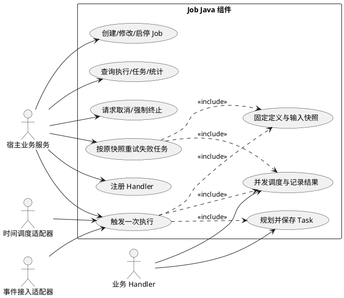
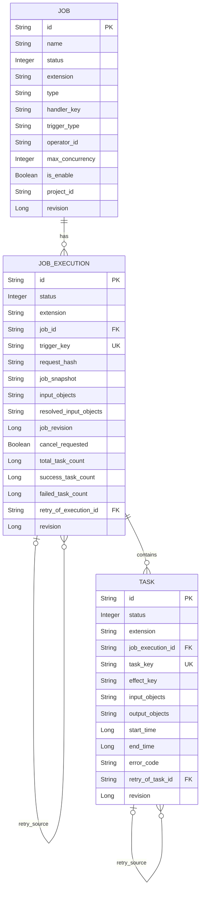
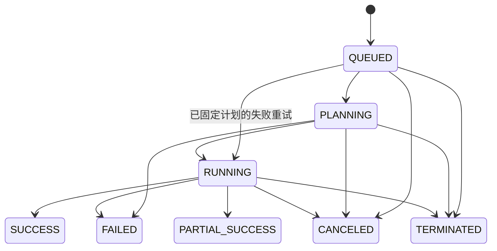
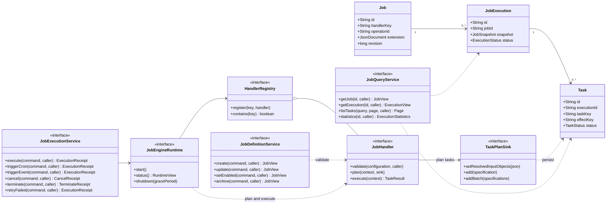

# Job Java 组件设计

版本：评审稿 v1.0  
日期：2026-10-20  
目标文档：https://synxlab-ta.feishu.cn/wiki/Rv6lwdnr5ifypTkqfPqcMFjTnoe

设计依据：已确认的会议结论与实体固定字段截图。最新 ER 源文档尚待访问权限，本文的新增字段、状态编码和索引属于评审建议，尚未完成与最新 ER 的逐项核对。

## 1. 组件定位

Job 引擎是嵌入业务服务的 Java 依赖组件，统一管理作业定义 Job、作业执行 JobExecution、原子任务 Task 三张表。组件对宿主提供 Java API，对业务代码提供 Handler SPI；前端 REST 接口由宿主业务服务实现，不属于引擎接口。

Job 保存可以重复运行的定义，JobExecution 表示一次触发，Task 表示该次执行中实际调度的业务单元。因此“作业执行与任务执行”是两级执行，持久化上仍然需要三种实体。一个 Job 可产生多次 JobExecution，每个有效 JobExecution 包含一个或多个 Task，Task 不跨执行复用。

本版优先支撑文本孵化与血缘孵化。采集只保留配置及输入输出结构的扩展能力，本月不交付采集 Handler。暂停、断点续传、DAG、任务自动重试、分布式抢占及多实例调度不属于本版。

### 1.1 职责边界

| 对象 | 负责内容 |
| --- | --- |
| 引擎组件 | 三表读写、定义快照、手工/Cron/事件触发、任务规划接收、并发调度、状态流转、执行统计、取消与终止、触发幂等 |
| 业务 JobHandler | 验证业务配置、解析并冻结输入范围、按业务粒度规划 Task、调用算子、保存元数据/血缘版本、返回结果引用 |
| 宿主业务服务 | 身份与权限、单位项目上下文、REST Controller、业务模板与文件查询、事件总线接入、组件生命周期 |
| 数据库适配器 | 事务、唯一约束、状态比较更新、三表查询；实现数据库方言差异 |

Java 17 为接口基线。核心 API 不暴露 Spring、ORM、HTTP 或具体算法 SDK 类型。DataSource、JSON 编解码、ID 生成、时钟与执行线程池通过配置/端口注入；可额外提供宿主框架适配模块。

### 1.2 本版运行模式

一个数据库隔离域只运行一个引擎调度实例，多个 Job 可并行运行；同一 Job 同时最多一个未终态执行。Job.maxConcurrency 限制一次执行内正在运行的 Task 数，实际并发同时受引擎全局线程上限约束。

Cron 本版采用含秒的 6 段表达式和显式 IANA 时区；调度适配器须按这个契约校验，不混用不同表达式方言。错过的时刻不追补；Job 忙时本次 Cron 跳过并记录日志。事件由宿主消费后调用 Java API，忙时返回可重试错误，由宿主保留消息重试。组件不暗含消息队列。

## 2. 用例设计

### 2.1 用例图

下图采用 UML 用例语法，宿主、时间调度器、事件适配器和业务 Handler 都是组件外部参与者。




### 2.2 用例清单

| 用例 | 前置条件与输入 | 主流程 | 结果与异常 |
| --- | --- | --- | --- |
| UC01 注册 Handler | 宿主初始化，handlerKey 唯一 | 注册对应业务代码，校验 key 与实现版本 | 就绪后允许启用对应 Job；重复注册返回 HANDLER_ALREADY_REGISTERED |
| UC02 管理定义 | 合法上下文、业务配置与预期修订号 | Handler 校验配置；引擎保存定义、触发配置和 extension | 更新只影响后续执行；修订冲突不覆盖原定义 |
| UC03 手工运行 | 已启用 Job，业务输入、requestKey | 幂等检查、Job 行级串行准入、写入 QUEUED 执行和快照 | 立即返回执行回执；异步规划/运行；忙时拒绝 |
| UC04 Cron 运行 | CRON Job，合法表达式/时区 | 根据 Job ID、计划时刻生成幂等键，走相同准入与执行流程 | 同一时刻不重复执行；忙时跳过，停用后无新触发 |
| UC05 事件运行 | EVENT Job，匹配 eventType，宿主提供 source/eventId | 按事件身份幂等触发，事件 payload 固定在本次输入 | 同事件不重复执行；忙/异常交由宿主重试；非匹配事件拒绝 |
| UC06 任务规划 | 执行处于 PLANNING，Handler 可用 | 冻结实际文件/字段版本；逐批持久化 Task；完成后封存计划 | 成功后才开始调度；空计划/规划错误导致 FAILED，已规划任务 SKIPPED |
| UC07 执行业务 | 执行处于 RUNNING，存在 PENDING Task | 在并发上限内调用 Handler.execute；记录输入输出和时间 | 返回 SUCCESS/SKIPPED；异常转 FAILED；任务异常不自动终止其他任务 |
| UC08 查看执行结果 | 已存在执行/任务 ID | 分页读取执行及任务，统计以已持久化状态为准 | 未终态不伪造结束时间；业务图谱通过 output 引用访问 |
| UC09 取消执行 | 非终态执行 | 设置取消标记，停止新调度，取消待执行任务，通知运行 Handler | 等待运行任务确认退出后 CANCELED；超时可进一步 terminate |
| UC10 终止执行 | 宿主已校验管理权限，非终态执行 | 设置 TERMINATED、封闭状态更新、尝试中断线程 | 保留已成功结果，迟到回调不再修改终态；不承诺回滚外部副作用 |
| UC11 重试失败任务 | 原执行终态且存在 FAILED Task | 创建新执行，复用原定义/输入快照，仅复制失败任务，继承 effectKey | 原执行不变；新执行建立来源关联，不重新 plan、不升级模板/算子 |

UC03 回执只表示已受理。Handler 丢失、算子失败或计划为空等异步错误在 JobExecution 中呈现，不能由前端自行写成功记录。

## 3. Java 服务接口详细设计

### 3.1 对外接口

```java
public interface JobDefinitionService {
    JobView create(CreateJobCommand command, CallContext caller);
    JobView update(UpdateJobCommand command, CallContext caller);
    JobView setEnabled(SetJobEnabledCommand command, CallContext caller);
    JobView archive(ArchiveJobCommand command, CallContext caller);
}

public interface JobExecutionService {
    ExecutionReceipt execute(RunJobCommand command, CallContext caller);
    ExecutionReceipt triggerCron(CronTriggerCommand command, CallContext scheduler);
    ExecutionReceipt triggerEvent(EventTriggerCommand command, CallContext consumer);
    CancelReceipt cancel(CancelExecutionCommand command, CallContext caller);
    TerminateReceipt terminate(TerminateExecutionCommand command, CallContext caller);
    ExecutionReceipt retryFailed(RetryFailedCommand command, CallContext caller);
}

public interface JobQueryService {
    JobView getJob(String jobId, CallContext caller);
    Page<JobView> listJobs(JobQuery query, PageRequest page, CallContext caller);
    ExecutionView getExecution(String executionId, CallContext caller);
    Page<ExecutionView> listExecutions(ExecutionQuery query, PageRequest page, CallContext caller);
    TaskView getTask(String taskId, CallContext caller);
    Page<TaskView> listTasks(TaskQuery query, PageRequest page, CallContext caller);
    ExecutionStatistics statistics(String executionId, CallContext caller);
}

public interface HandlerRegistry {
    void register(String handlerKey, JobHandler handler);
    boolean contains(String handlerKey);
}

public interface JobEngineRuntime extends AutoCloseable {
    void start();
    RuntimeView status();
    void shutdown(Duration gracePeriod);
    void close();
}
```

本组件对宿主暴露 5 个 Java 接口，共 23 个方法。Job 是可重复运行的作业定义，JobExecution 是一次执行记录，Task 是该次执行中的原子任务；定义管理、执行控制、结果查询、业务注册和运行时管理分别由以下接口负责。

#### 3.1.1 JobDefinitionService：作业定义管理

| 方法 | 含义 | 参数 | 返回结果与约定 |
| --- | --- | --- | --- |
| create | 新建可重复运行的作业定义 | CreateJobCommand：名称、业务类型、Handler 标识、触发配置及业务扩展；caller：调用上下文 | JobView：保存后的定义及 ID、修订号；创建定义本身不执行任务 |
| update | 修改已有作业定义 | UpdateJobCommand：jobId、expectedRevision 及可修改配置；caller | JobView：修改后的定义；已受理执行继续使用原快照，后续执行使用新配置 |
| setEnabled | 启用或停用作业的新触发 | SetJobEnabledCommand：jobId、enabled、expectedRevision；caller | JobView：当前定义；停用不取消已在执行的任务 |
| archive | 归档不再使用的作业定义 | ArchiveJobCommand：jobId、expectedRevision；caller | JobView：已归档且停用的定义；保留执行历史，有未终态执行时拒绝归档 |

#### 3.1.2 JobExecutionService：执行触发与控制

| 方法 | 含义 | 参数 | 返回结果与约定 |
| --- | --- | --- | --- |
| execute | 手工触发 Job 的一次新执行 | RunJobCommand：jobId、requestKey、inputObjects，可选本次并发配置；caller | ExecutionReceipt：executionId、受理时状态、受理时间及是否复用原请求；受理后在后台规划和执行，不代表业务已完成 |
| triggerCron | 接受定时调度适配器的触发 | CronTriggerCommand：jobId、scheduledTime、scheduleRevision；scheduler：调度器上下文 | ExecutionReceipt；只接受匹配的 CRON 定义，按计划时刻和配置修订号去重 |
| triggerEvent | 接受宿主事件适配器的触发 | EventTriggerCommand：jobId、eventSource、eventId、eventType、payload；consumer：事件消费者上下文 | ExecutionReceipt；校验事件类型并按事件身份去重；宿主负责消费消息和确认处理 |
| cancel | 请求协作取消某一次执行 | CancelExecutionCommand：executionId，可选 reason；caller | CancelReceipt：是否受理、取消标记和当前状态；停止新任务调度，并通知运行中的 Handler 退出，返回时可能仍在收尾 |
| terminate | 强制将某一次执行封闭为终止状态 | TerminateExecutionCommand：executionId、reason；caller | TerminateReceipt：是否变更、当前状态及是否可能仍有外部副作用；封闭非终态任务并拒绝迟到状态提交，不能保证外部调用立即停止或回滚 |
| retryFailed | 按原快照重新执行失败的子任务 | RetryFailedCommand：原 executionId、requestKey，可选 taskIds；caller | 新执行的 ExecutionReceipt；仅复制选中的 FAILED Task，保留原执行和结果；不重新规划输入、不替换原模板或算子 |

execute、triggerCron、triggerEvent、retryFailed 均返回受理回执；调用方随后通过 JobQueryService 查询进度与结果。使用相同幂等身份重复提交时复用原执行，同一身份携带不同请求内容时返回冲突。

#### 3.1.3 JobQueryService：定义、执行与任务查询

| 方法 | 含义 | 参数 | 返回结果与约定 |
| --- | --- | --- | --- |
| getJob | 查看一份作业定义 | jobId：作业定义 ID；caller | JobView：配置、启用状态、触发类型和修订号等 |
| listJobs | 分页查询作业定义列表 | JobQuery：关键词、业务类型、Handler、启用状态等筛选条件；PageRequest：分页排序；caller | `Page<JobView>`：定义列表、总数及分页信息 |
| getExecution | 查看一次作业执行详情 | executionId：执行 ID；caller | ExecutionView：执行状态、定义及输入快照、起止时间、统计、错误信息等 |
| listExecutions | 分页查询作业执行历史 | ExecutionQuery：jobId、业务类型、执行状态、触发类型和时间范围等；PageRequest；caller | `Page<ExecutionView>`；同一 Job 的多次运行分别展示 |
| getTask | 查看一个原子任务详情 | taskId：子任务 ID；caller | TaskView：状态、固定输入、输出引用、起止时间、错误和重试来源等 |
| listTasks | 分页查询一次执行中的子任务 | TaskQuery：executionId 必填，状态、关键词、businessKey 可选；PageRequest；caller | `Page<TaskView>`；任务粒度由 Handler 决定，可按文件、表或字段展示 |
| statistics | 查询一次执行的整体任务统计 | executionId；caller | ExecutionStatistics：计划是否完成、已规划及总任务数，以及待执行、运行、成功、失败、跳过、取消、终止数量；计划未封存时总任务数可为空 |

#### 3.1.4 HandlerRegistry：业务执行器注册

| 方法 | 含义 | 参数 | 返回结果与约定 |
| --- | --- | --- | --- |
| register | 将业务 Handler 实现绑定到引擎中的唯一标识 | handlerKey：如 metadata.text.v1；handler：实现 validate、plan、execute 的业务对象 | void；启动前完成注册，重复 key 拒绝注册，运行期间不允许覆盖或卸载 |
| contains | 检查某个 Handler 是否已注册 | handlerKey：待检查标识 | boolean；只表示实现已注册，不代表外部算子服务健康或某个 Job 配置有效 |

#### 3.1.5 JobEngineRuntime：引擎生命周期管理

| 方法 | 含义 | 参数 | 返回结果与约定 |
| --- | --- | --- | --- |
| start | 启动引擎运行时 | 无 | void；校验持久化与运行配置、处理遗留执行，然后启动调度；单个 Job 的手工执行仍需调用 execute |
| status | 查看引擎自身的运行状态 | 无 | RuntimeView：实例 ID、生命周期状态、活跃执行数、运行任务数、线程上限和已注册 Handler 标识；不是某个 Job 的执行详情 |
| shutdown | 在指定宽限期内关闭引擎 | gracePeriod：等待在途执行自然结束的 Duration | void；先停止接收新执行和自动触发，等待在途执行，宽限期结束后终止剩余执行并释放引擎资源 |
| close | 使用默认宽限期关闭引擎 | 无 | void；使用已配置的默认宽限期执行关闭，释放引擎资源；不关闭宿主共享的 DataSource |

#### 3.1.6 公共参数与返回对象

| 名称 | 含义 |
| --- | --- |
| CallContext | 由可信宿主提供的调用上下文，包含 actorId、projectId、traceId；宿主先完成权限校验，引擎按上下文隔离访问范围 |
| caller / scheduler / consumer | 三者类型均为 CallContext；变量名分别表示业务调用者、定时调度器、事件消费者，不是三个不同接口 |
| XxxCommand | 修改操作的输入对象，封装本次操作所需参数；expectedRevision 用于检测并发修改，requestKey 用于触发去重 |
| JobQuery / ExecutionQuery / TaskQuery | 只读查询的筛选条件对象；不携带修改指令 |
| PageRequest / `Page<T>` | 前者指定页码、每页条数和排序；后者包含 items、total、page、pageSize |
| JobView / ExecutionView / TaskView | 对外返回的定义、执行、子任务详情 DTO，不直接暴露数据库实体 |
| ExecutionReceipt | 执行受理回执；获得 executionId 后查询实际进度，不能当作执行成功结果 |
| CancelReceipt / TerminateReceipt | 取消请求回执和终止处理回执，分别说明请求是否受理或状态是否改变 |
| ExecutionStatistics / RuntimeView | 前者描述一次执行中的任务统计；后者描述整个引擎实例的运行情况 |
| JobHandler | 宿主实现的业务 SPI；注册后由引擎回调校验配置、规划 Task 和执行业务，不是引擎自动提供的算法实现 |

### 3.2 定义服务

| 方法名称 | 参数与约束 | 返回结果 | 状态与错误 |
| --- | --- | --- | --- |
| create | CreateJobCommand、CallContext；name/type/handlerKey/triggerType 必填，extension 为合法 JSON 对象 | JobView，revision=1，status=ACTIVE | Handler 先校验配置；缺失 Handler、非法触发配置拒绝；isEnable 默认 true |
| update | UpdateJobCommand：jobId、expectedRevision、完整可编辑配置；项目和业务 type 不可变 | 更新后的 JobView | 只改定义；已有执行继续使用快照；归档定义不可改；冲突 REVISION_CONFLICT |
| setEnabled | jobId、enabled、expectedRevision | JobView | 停用只阻止未来触发，不取消已有执行；重复目标状态仍检查 revision |
| archive | jobId、expectedRevision | JobView，status=ARCHIVED、isEnable=false | 有未终态执行返回 JOB_BUSY；保留三表历史，不做级联删除 |

`CreateJobCommand / UpdateJobCommand` 的配置字段：

| 字段 | Java 类型 | 必填 | 约束与含义 |
| --- | --- | --- | --- |
| jobId / expectedRevision | String / long | 仅更新 | 精确定义及预期修订号 |
| name | String | 是 | 1～128 字符 |
| description | String | 否 | 最多 2000 字符 |
| type | String | 是 | 开放业务类型，如 ENRICH_TXT/ENRICH_LIN；引擎不穷举业务枚举 |
| handlerKey | String | 是 | 已注册的 Handler key，更新时允许切换到兼容配置的新实现；不影响旧快照 |
| triggerType | TriggerType | 是 | MANUAL/CRON/EVENT |
| cronExpression / timeZone | String / String | CRON 必填 | 非 CRON 不传；含秒 6 段表达式与 IANA 时区 |
| eventType | String | EVENT 必填 | 非 EVENT 不传；宿主订阅规则由宿主管理 |
| maxConcurrency | int | 否 | 默认 1，范围 1～100；每次执行内 Task 并发上限 |
| isEnable | boolean | 否 | 创建默认 true |
| operatorId | String | 否 | 不透明业务算子引用；孵化 Handler 校验是否必填及可用，引擎不读算子表 |
| extension | JsonDocument | 是 | JSON 对象，包含 metadataTemplateId 等业务参数；禁止保存明文凭证 |

projectId 取 CallContext，不能在命令中变更。operatorId 作为 Job 定义的可选业务引用，本文采用独立可索引列；不在引擎数据库建立到业务算子表的强外键。

### 3.3 执行服务

| 方法名称 | 请求字段 | 返回结果 | 详细约定 |
| --- | --- | --- | --- |
| execute | RunJobCommand：jobId、requestKey、inputObjects；maxConcurrencyOverride 可选 | ExecutionReceipt | 各触发配置的已启用 Job 均可手工运行；triggerType=MANUAL；覆写只支持本次并发，不允许改模板/算子 |
| triggerCron | CronTriggerCommand：jobId、scheduledTime、scheduleRevision | ExecutionReceipt | 仅 CRON Job；scheduleRevision 与当前配置不一致返回 STALE_TRIGGER；逻辑幂等键由组件生成 |
| triggerEvent | EventTriggerCommand：jobId、eventSource、eventId、eventType、payload | ExecutionReceipt | 仅 EVENT Job；eventType 需匹配；调用成功后宿主才可确认消息 |
| cancel | CancelExecutionCommand：executionId、reason 可选 | CancelReceipt | 终态返回 accepted=false/currentStatus；非终态幂等设置取消意图，不同步声称线程已退出 |
| terminate | TerminateExecutionCommand：executionId、reason 必填 | TerminateReceipt | 原子封闭执行及非终态 Task，拒绝迟到提交；返回 mayHaveInFlightEffects，宿主检查业务副作用 |
| retryFailed | RetryFailedCommand：executionId、requestKey、taskIds 可选 | ExecutionReceipt | 原执行必须终态；默认选择全部 FAILED Task，显式列表必须均属于原执行且失败；不自动重试 TERMINATED |

`RunJobCommand`：

| 字段 | Java 类型 | 必填 | 说明 |
| --- | --- | --- | --- |
| jobId | String | 是 | 作业定义 |
| requestKey | String | 是 | 调用方生成，1～128 字符；同 Job 同 key 表示同一操作 |
| inputObjects | JsonDocument | 是 | JSON 数组，可为 []；供 Handler 解析原始业务输入，不是任意 Java 对象序列化 |
| maxConcurrencyOverride | Integer | 否 | 1～100，仍受全局线程配额约束 |

`ExecutionReceipt`：`executionId: String`、`jobId: String`、`status: ExecutionStatus`、`acceptedTime: long`、`reused: boolean`。相同键、相同规范化请求返回原 executionId/reused=true；相同键、不同请求返回 IDEMPOTENCY_CONFLICT。重复请求先检查已存在执行，再检查 Job 是否忙/已停用，保证原回执可重复获取；仍需校验调用权限。

幂等身份：手工为 MANUAL + requestKey；Cron 为 CRON + scheduledTime + scheduleRevision；事件为 EVENT + eventSource + eventId；重试为 RETRY + requestKey。最终与 jobId 组合建立唯一约束。请求摘要排除 traceId 等观测字段，包含业务输入、调用项目和有效覆写，原始凭证不参与保存。

`CancelReceipt`：`executionId: String`、`accepted: boolean`、`cancelRequested: boolean`、`status: ExecutionStatus`、`requestedTime: Long`。

`TerminateReceipt`：`executionId: String`、`changed: boolean`、`status: ExecutionStatus`、`mayHaveInFlightEffects: boolean`、`reason: String`。

retryFailed 仍需当前 Job 未归档、已启用且无在途执行，原 handlerKey 也必须可用；通过准入后使用旧快照，不能套用当前模板、算子或 Handler。复制计划完成后新执行可由 QUEUED 直接进入 RUNNING，无需重新解析目录。历史结果引用和重试源均保持可追溯。

其余执行命令的字段契约如下；表中字段除特别注明外均为必填，调用上下文通过独立的 CallContext 传入：

| 命令 | 字段、Java 类型与约束 |
| --- | --- |
| CronTriggerCommand | jobId:String；scheduledTime:Instant，预定触发的 UTC 时刻；scheduleRevision:long，生成该计划时读取的 Job.revision。三者参与校验或幂等，不接受调用者自造 triggerKey |
| EventTriggerCommand | jobId:String；eventSource:String（1～128 字符）；eventId:String（1～128 字符）；eventType:String（1～128 字符）；payload:JsonDocument，JSON 对象。引擎将事件信封封装为本次 inputObjects 的 EVENT 项，Handler 在 plan 中解析 |
| CancelExecutionCommand | executionId:String；reason:String 可选，最多 2000 字符。首次原因与请求时间写入执行 extension.engine.control，后续相同请求不覆盖首次原因 |
| TerminateExecutionCommand | executionId:String；reason:String，1～2000 字符。原因和操作人写入 extension.engine.control；终态执行重复调用 changed=false |
| RetryFailedCommand | executionId:String；requestKey:String（1～128 字符）；taskIds:`List<String>` 可选，省略表示全部失败任务；显式列表须非空且无重复。幂等摘要包含原 executionId 和排序后的任务集合 |
| SetJobEnabledCommand | jobId:String；expectedRevision:long（大于 0）；enabled:boolean |
| ArchiveJobCommand | jobId:String；expectedRevision:long（大于 0） |

### 3.4 查询服务

| 方法 | 查询参数 | 响应与约束 |
| --- | --- | --- |
| getJob / getExecution / getTask | 对应 ID、CallContext | 返回确定资源；不在调用范围内按统一 NOT_FOUND/FORBIDDEN 策略处理 |
| listJobs | JobQuery：keyword、type、handlerKey、enabled、jobStatus 均可选 | `Page<JobView>`；只搜索宿主允许的项目范围 |
| listExecutions | ExecutionQuery：jobId、type、executionStatus、triggerType、startTimeFrom、startTimeTo 均可选 | `Page<ExecutionView>`；有 endTime 才返回最终 costMillisecond |
| listTasks | TaskQuery：executionId 必填；taskStatus、keyword、businessKey 可选 | `Page<TaskView>`；businessKey 是可索引的业务分组键，孵化业务可传锚定 fileId；组件不假设所有 Task 都对应一个文件 |
| statistics | executionId | ExecutionStatistics；使用同一数据库快照计算状态计数，避免多次无事务查询产生互相矛盾的统计 |

`PageRequest`：`page: int=1`、`pageSize: int=20`（1～200）、`sorts: List<SortItem>`。SortItem 为 `field: String`、`direction: ASC/DESC`；Jobs 允许 name/createdTime/lastUpdatedTime，Executions 允许 createdTime/startTime/endTime，Tasks 允许 createdTime/startTime/endTime，均追加 id 保证稳定。不接受任意 SQL 排序表达式。

`Page<T>`：`items: List<T>`、`total: long`、`page: int`、`pageSize: int`。

### 3.5 Handler SPI

```java
public interface JobHandler {
    void validate(JobConfiguration configuration, CallContext caller);
    void plan(PlanningContext context, TaskPlanSink sink) throws Exception;
    TaskResult execute(TaskContext context) throws Exception;
}

public interface TaskPlanSink {
    void setResolvedInputObjects(JsonDocument frozenInputs);
    void add(TaskSpec specification);
    void addBatch(List<TaskSpec> specifications);
}

public interface CancellationToken {
    boolean isCancellationRequested();
    void throwIfCancellationRequested();
}

public record JsonDocument(String value) {}
public record TaskSpec(String taskKey, String businessKey, String name,
                       JsonDocument inputObjects, JsonDocument extension) {}
public record TaskResult(TaskOutcome outcome,
                         JsonDocument outputObjects, JsonDocument extension) {}
```

JsonDocument 是组件自己的不可变 JSON 值类型，构造时检查语法、大小及所需根类型。API 不绑定 Jackson JsonNode；默认限制单个 JSON 参数为 1 MiB，可由引擎配置收紧或放宽，大范围输入通过已冻结 manifest 引用表达。input/output 根为数组，extension 根为对象。

| 回调 | 输入与字段 | 返回/副作用 | 错误与并发约定 |
| --- | --- | --- | --- |
| validate | JobConfiguration 为定义配置快照 | 无返回；业务检查模板、算子与配置组合 | 业务校验失败抛 BusinessConfigurationException；在长事务外执行，落库前复核定义 revision |
| plan | PlanningContext：executionId、jobSnapshot、requestedInputObjects、caller、cancellationToken | 先 setResolvedInputObjects 固定实际文件/字段版本，再 add/addBatch；整个回调正常结束视为计划完成 | 同一执行只规划一次；本版无规划重入恢复；失败不调度已写入任务 |
| execute | TaskContext：jobSnapshot、executionId、taskId、taskKey、effectKey、taskInputObjects、executionInputObjects、taskExtension、caller、cancellationToken | 同步返回 TaskResult；output 只存业务对象/结果引用 | 同 Handler 可同时处理多个 Task，必须线程安全；未捕获异常转 FAILED；不得自行修改引擎三表 |
| setResolvedInputObjects | 合法 JSON 数组或 manifest 对象引用数组 | 一次性固定执行分析范围 | 必须在第一个 add 前完成；重复不同内容/任务写入后再改返回 PLAN_INPUT_FROZEN |
| add/addBatch | TaskSpec，taskKey 必填、执行内唯一；批次最大 200 | 引擎持久化 PENDING Task，生成 taskId/effectKey | 同 taskKey 同规范化内容忽略重复；内容不同返回 TASK_KEY_CONFLICT；取消/终止后拒绝写入 |

TaskOutcome 只允许 SUCCESS/SKIPPED；失败通过异常表达，取消通过令牌检查表达。TaskResult.extension 只合并到 task.extension.businessResult，不得覆盖 engine 保留命名空间。Handler 写业务结果前后都应检查取消意图，外部 SDK 调用需设定超时。

throwIfCancellationRequested 抛出组件自己的 TaskCancellationException。只有控制流程已登记取消或终止时，运行时才将该异常解释为控制退出；没有对应意图的异常按业务失败处理，防止 Handler 无意将真实错误标记为取消。

规划期间不执行 Task。只有计划正常完成、输入被冻结且任务数大于 0，才由 PLANNING 转 RUNNING；可避免一边生成范围、一边执行导致全局血缘上下文不完整。

TaskSpec.taskKey 为 1～128 字符，name 为 1～128 字符；businessKey 可空，非空时最多 255 字符，供宿主按文件/表等业务目标分组。TaskResult.outcome=SKIPPED 时 outputObjects 通常为 []，在 extension.businessResult.reason 中返回明确跳过原因。

### 3.6 返回 DTO

| DTO | 字段与 Java 类型 |
| --- | --- |
| CallContext | actorId:String、projectId:String 可空、traceId:String 可空；权限由宿主在进入组件前校验 |
| JobView | id/name/description/type/handlerKey:String；status:JobStatus；isEnable:boolean；triggerType:TriggerType；cronExpression/timeZone/eventType/operatorId/projectId:String 可空；maxConcurrency:int；extension:JsonDocument；revision:long；creatorId/lastOperatorId:String 可空；createdTime/lastUpdatedTime:long |
| JobSnapshot | jobId/name/type/handlerKey:String；jobRevision:long；operatorId/projectId:String 可空；maxConcurrency:int；extension:JsonDocument；triggerConfig:TriggerConfiguration；固定于受理时，不跟随 Job 后续修改 |
| ExecutionView | id/jobId/name:String；status:ExecutionStatus；triggerType:TriggerType；triggerAgentId:String 可空；jobSnapshot:JobSnapshot；requestedInputObjects/resolvedInputObjects:JsonDocument；statistics:ExecutionStatistics；cancelRequested:boolean；startTime/endTime/costMillisecond:Long 可空；createdTime:long；errorCode/errorMessage/retryOfExecutionId:String 可空；revision:long |
| TaskView | id/executionId/taskKey/effectKey/name:String；businessKey:String 可空；status:TaskStatus；inputObjects/outputObjects/extension:JsonDocument；startTime/endTime/costMillisecond:Long 可空；createdTime:long；errorCode/errorMessage/retryOfTaskId:String 可空；revision:long |
| ExecutionStatistics | planningComplete:boolean；plannedTaskCount:long；totalTaskCount:Long（规划中为空）；pending/running/success/failed/skipped/canceled/terminatedTaskCount:long；planned=七种 Task 状态之和；total 在计划完成后等于 planned |
| RuntimeView | runtimeId:String；state:NEW/RUNNING/STOPPING/STOPPED；activeExecutionCount:int；runningTaskCount:int；maxWorkerThreads:int；registeredHandlerKeys:`Set<String>` |

### 3.7 异常契约

服务方法抛出统一 JobEngineException，包含 code、message、retryable 和 traceId，不含 HTTP 状态码。宿主 Controller 自行映射 HTTP。异步 Handler 异常写入执行/任务错误字段，不把堆栈或凭证放进前端可见错误。

| code | 场景 | 可重试 |
| --- | --- | --- |
| INVALID_ARGUMENT / INVALID_JSON / INVALID_CRON | 参数、JSON 根类型或触发表达式错误 | 否 |
| NOT_FOUND / FORBIDDEN | 不存在或宿主权限检查失败 | 否 |
| REVISION_CONFLICT | 定义修改/状态比较更新冲突 | 重新读取后可重试 |
| HANDLER_NOT_FOUND / HANDLER_ALREADY_REGISTERED | 未注册或重复注册 | 修正配置后 |
| JOB_DISABLED / JOB_ARCHIVED | 作业停用或归档 | 否 |
| JOB_BUSY / ENGINE_STOPPING | Job 已有未终态执行或运行时关闭中 | 是 |
| IDEMPOTENCY_CONFLICT / TASK_KEY_CONFLICT | 相同身份对应不同内容 | 否 |
| STALE_TRIGGER / EVENT_TYPE_MISMATCH | 过时 Cron 配置或事件类型不匹配 | 否 |
| EMPTY_PLAN / PLAN_FAILED | 没有有效输入或业务规划失败 | 依业务修正 |
| RESULT_NOT_READY / INVALID_STATE | 查询未完成结果或不允许的状态转换 | 按当前状态判断 |
| TASK_FAILED / EXECUTION_TERMINATED | 业务异常或不可恢复运行时中断 | 原因明确后人工处理 |

### 3.8 组件生命周期

start 校验三表结构、Handler 注册、线程参数和运行实例独占配置，再恢复本实例隔离域内遗留未终态执行。已有无法继续的执行与非终态 Task 标为 TERMINATED，保存 RESTART_INTERRUPTED，**不自动重放业务代码**。宿主必须确保同一隔离域没有另一个活跃调度实例，不能将此恢复规则用于多实例运行。

shutdown 先停止新准入和自动触发，等待 gracePeriod 内的执行自然结束；超时后对剩余执行执行 terminate，保留可能仍在外部运行的副作用提示。close 等价于使用配置的默认宽限期关闭。DataSource 的生命周期归宿主管理，组件不关闭共享连接池。

## 4. 实体关系与 ER 图

### 4.1 实体关系

| 关系 | 基数 | 说明 |
| --- | --- | --- |
| Job → JobExecution | 1:N | 一份定义可多次运行；执行保存 jobRevision 和配置快照 |
| JobExecution → Task | 1:N，规划中暂为 0 | Task 必须归属于一次执行；任务粒度由 Handler 决定 |
| JobExecution → 原 JobExecution | N:0..1 | retryOfExecutionId 表示失败重试来源，不改写原执行 |
| Task → 原 Task | N:0..1 | retryOfTaskId 表示复制的失败任务；effectKey 沿重试链保持一致 |
| Job → Operator | 可选外部引用 | operatorId 为业务 ID，引擎不拥有 Operator 实体、不建立强外键 |

三张表使用项目统一固定字段：id、name、description、status、extension、creator_id、created_time、last_operator_id、last_updated_time。电子表格中这些行保持白底，后续专属字段使用浅蓝底；字段“允空”列 N 表示不允许空、Y 表示允许空。

以下字段与编码为组件实现设计建议；需要与源 ER 的最终命名同步。完整数据库字段字典见下方可编辑电子表格。

### 4.2 ER 图



图中 UK 表示参与复合唯一键，不表示 trigger_key、task_key 全表单列唯一。Job/Execution/Task 都具有上述九个固定字段；图中只展开核心业务字段，完整字段、空值和说明见电子表格。

### 4.3 数据库电子表格

在线工作簿：[Job Java组件数据库设计](https://synx.feishu.cn/sheets/LYjmslxlzht0IotynFxcbGITnsg)。包含 Job、JobExecution、Task、状态字典、索引约束五张工作表。

表头按参考图采用两行实体名称/物理表名，第三行为“字段、类型、允空、说明”；九个固定字段在每个实体表中完整重复并保持白底，业务专属字段为浅蓝底，“允空”使用 Y/N 下拉校验。对应物理表为 tbl_job、tbl_job_execution、tbl_job_task。

本地可编辑副本：[job-engine-database.xlsx](../../outputs/job-java-component/job-engine-database.xlsx)。在线文档版在本节嵌入各工作表。

### 4.4 JSON 字段约定

extension 的公共形状为 `{schemaVersion:1,business:{...},engine:{...}}`。宿主写 Job.extension.business，engine 命名空间只由组件维护。Execution 的快照保留原业务配置；Task 的业务输入扩展由 TaskSpec.extension 写入 business，业务执行附加结果放 businessResult。所有 JSON 字段以 String 描述逻辑类型，落库可采用数据库支持的 JSON/TEXT，不将字符串长度固定为 255。

文本孵化 Job.extension 示例：

```json
{
  "schemaVersion": 1,
  "business": {
    "metadataTemplateId": "template-v1",
    "contentMode": "TEXT",
    "selection": { "mode": "EXPLICIT_FILES", "fileIds": ["file-a-v1", "file-b-v2"] }
  },
  "engine": {}
}
```

operatorId 独立存放于 Job.operator_id，不在 extension 中再复制另一份可编辑值。模板、连接配置和存储目录属于业务扩展：文本 metadataTemplateId 必填；血缘无需该字段；采集预留 connectionConfigId、storageDirectoryId、sources，不再单独设计 IngestionJob/EnrichTextJob 扩展表。

input_objects 和 output_objects 是对象引用数组，各业务类型通过 kind 区分，未知 kind 由 Handler 验证，引擎只负责 JSON 与通用大小校验：

```json
[
  { "kind": "FILE", "fileId": "file-a-v1", "fileName": "订单表", "fileType": "STRU" },
  { "kind": "METADATA_VERSION", "fileId": "file-a-v1", "metadataVersionId": "mv-001" },
  { "kind": "LINEAGE_VERSION", "lineageVersionId": "lv-001" }
]
```

上例展示可用引用类型，不表示一次调用必须混合全部种类。采集未来可在输出对象的 `attachments` 中附 SQL/查询计划等引用，如 `{kind:"SQL",objectUri:"oss://.../query.sql",checksum:"..."}`；短说明可放 Task.extension.businessResult。禁止把密钥、临时授权 URL 或超大原始结果塞进三表。

## 5. 状态、事务与执行约束

### 5.1 状态模型

Job.status 表达 ACTIVE/ARCHIVED，isEnable 表达是否允许新触发，两者不混用。执行和任务状态的数据库 Integer 编码在电子表格“状态字典”中单独列出，Java API 使用枚举名称，禁止使用 enum.ordinal() 持久化。



Task：PENDING → RUNNING → SUCCESS/FAILED/SKIPPED；取消时 PENDING 可转 CANCELED，RUNNING 在 Handler 确认退出后转 CANCELED。强制终止时 PENDING/RUNNING 转 TERMINATED。终态不可反转。

正常完成聚合规则：无失败且全部 SUCCESS/SKIPPED 为 SUCCESS；有 SUCCESS 且有 FAILED 为 PARTIAL_SUCCESS；有 FAILED 且无 SUCCESS 为 FAILED，SKIPPED 不计成功。显式取消/终止以控制流程为准；取消后仍保留此前成功任务。没有 Task 的计划为 EMPTY_PLAN/FAILED。

取消请求与完成发生竞争时，以数据库状态比较更新的成功顺序决定结果：若任务完成/执行聚合终态已提交，后续取消返回未受理；若取消标记先提交，则禁止执行再聚合为 SUCCESS/PARTIAL_SUCCESS/FAILED，等待收尾后为 CANCELED。

### 5.2 三表事务与幂等

| 操作 | 数据一致性要求 |
| --- | --- |
| 触发准入 | 锁定 Job 行，先查幂等身份，再检查启用/归档/未终态执行；同一事务写 JobExecution 和 jobSnapshot，提交后异步调度 |
| 计划写入 | 单批 Task 持久化独立短事务；`(job_execution_id,task_key)` 唯一；只有整轮 plan 成功才调度 |
| Task 领取与完成 | 按 status+revision 比较更新，PENDING 只领取一次；任务终态提交和执行计数更新在同一事务，防止重复计数 |
| 执行收尾 | 锁定执行，读取所有任务状态并检查取消/终止意图后决定终态；先提交 end_time，再向查询方报告完成 |
| 归档定义 | 检查无未终态执行，关闭触发并保留历史；外键不配置级联删除 |
| 失败重试 | 基于旧快照生成新执行和失败 Task，保留 retryOf 链；无需新增 attempts 表，重试历史通过执行/任务关联查询 |

组件只保证引擎三表内的状态和计数事务，不宣称业务数据库/算法服务与三表跨资源原子提交。Handler 保存业务结果时应以 effectKey 做幂等：第一次 Task 生成 effectKey，失败重试继承该值。若业务结果已提交而引擎回执丢失，重试应复用已有结果引用。

本版不自动重跑进程中断任务，以免重复调用外部算法或重复发布结果。终止只封闭引擎状态，无法撤销已经发生的外部副作用；宿主按错误原因检查并决定补偿或新建作业。

## 6. 文本与血缘孵化接入

### 6.1 文本孵化 Handler

Job 配置包含 operatorId、extension.business.metadataTemplateId 和文件选择范围。plan 把模板、算子、实际文件版本和模板原生字段策略固定到执行/任务快照，按文件生成 Task；每个 Task 输入一个确定文件版本。

execute 调用算子、以 effectKey 幂等保存元数据版本容器及 JSON 结果，再返回 METADATA_VERSION 引用。内容/文本结果不包含血缘；原生字段解析与展示不依赖本次孵化，模板只控制纳入规则。

### 6.2 血缘孵化 Handler

Job 指定 operatorId、文件集合以及业务可选粒度策略，不要求 metadataTemplateId。plan 先冻结本次全局分析范围，再按“某表全部字段”或“某表单字段”生成 Task，由业务决定具体粒度，不由引擎写死。

Task.extension.business 可包含 anchorFileId、metadataDefinitionId、analysisScopeManifestId、granularity 等，businessKey 可设为 anchorFileId。每个 Task 同时获得本次 executionInputObjects，所以分析一个目标字段时仍能读取其他表/字段的上下文。

execute 发布血缘版本容器与关系，output 返回 LINEAGE_VERSION 引用。FILE/METADATA 两种关系均采用上游 → 锚定端，字段端点使用确定文件版本与元数据定义 ID，不把相关性自动当作已确认业务血缘。

### 6.3 宿主使用示例

```java
registry.register("metadata.text.v1", textHandler);
registry.register("metadata.lineage.v1", lineageHandler);
runtime.start();

JobView job = definitions.create(textJobCommand, caller);
ExecutionReceipt receipt = executions.execute(
    new RunJobCommand(job.id(), "request-001", selectedFilesJson, 4), caller);

ExecutionView execution = queries.getExecution(receipt.executionId(), caller);
Page<TaskView> tasks = queries.listTasks(
    taskQueryFor(receipt.executionId()), firstPage(), caller);
```

示例中的业务命令构造、JSON 和查询构造方法由宿主完成；组件不会创建 HTTP 路由，也不会替代元数据、血缘图谱查询服务。

## 7. 服务与实体类图


